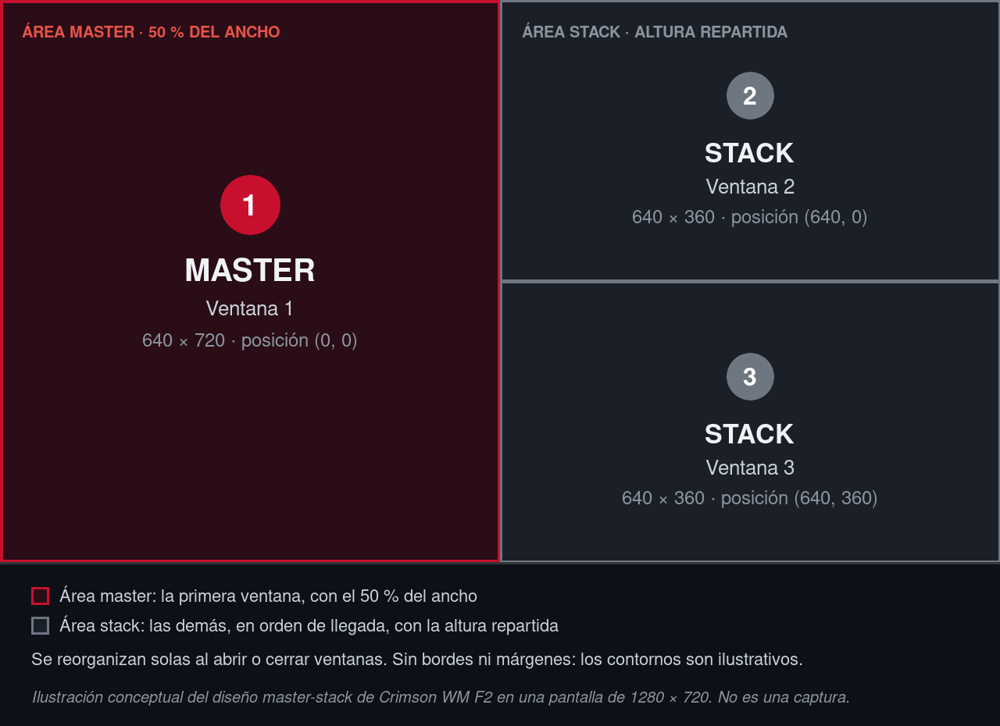
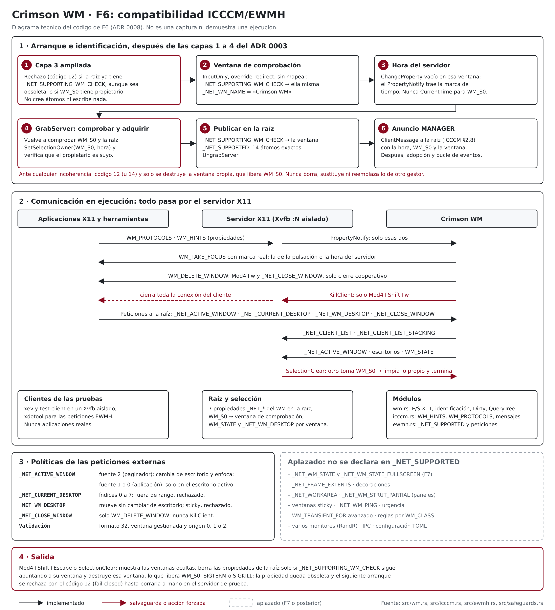
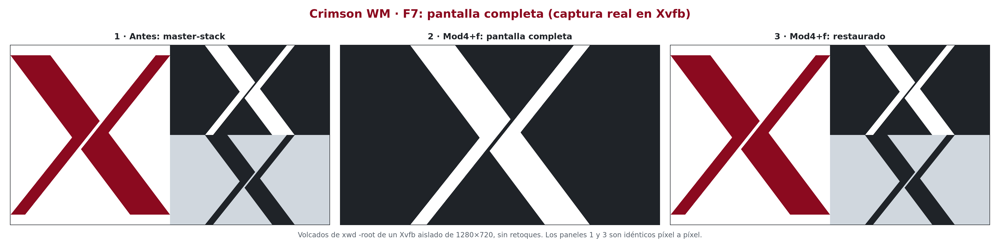
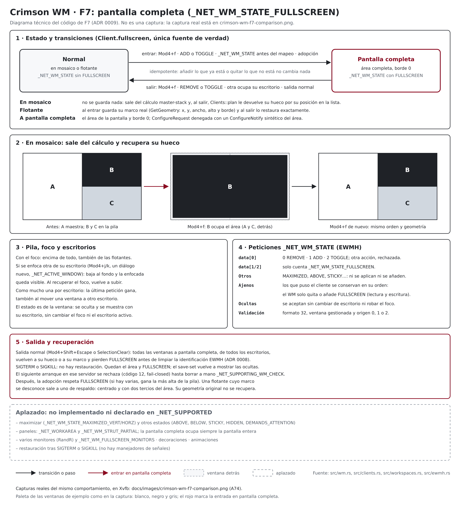

# Crimson WM

Gestor de ventanas para X11, escrito en Rust y dirigido inicialmente a
Debian 13 (Trixie), orientado a la gestión de ventanas en mosaico. Por ahora
es un prototipo con un único diseño, master-stack, ocho escritorios
virtuales, pantalla completa y compatibilidad parcial con ICCCM y EWMH (ver
«Estado»).

## Estado

Fase F7: pantalla completa (`Mod4+f` y `_NET_WM_STATE_FULLSCREEN`), sobre
la compatibilidad ICCCM/EWMH, los escritorios virtuales, el lanzamiento de
aplicaciones, el foco por teclado y el mosaico master-stack. **Todavía no es
un gestor de ventanas utilizable:** solo arranca en un servidor X de prueba
que supere las salvaguardas del ADR 0003, coloca las ventanas normales en
mosaico, deja flotantes los diálogos, gestiona el foco con el teclado,
reparte las ventanas en ocho escritorios, pone una ventana a pantalla
completa, cierra ventanas, lanza seis programas fijos y termina con el
atajo provisional `Mod4+Shift+Escape`. No tiene ratón, decoraciones,
paneles, varios monitores ni configuración.

Las cuatro capas de salvaguardas están implementadas desde P4
(2026-10-11). Últimos resultados registrados, todos del 2026-10-14 en Xvfb
sobre el binario de depuración de F7 (detalles y limitaciones en los ADR
0003 a 0009):

- Pruebas unitarias U1–U18 (105 pruebas de `cargo test`): pasaron.
- Aceptación de F7: A63 y A65–A74 pasaron y **A75 quedó parcial**, porque
  la consulta de la raíz de `:0` se omite deliberadamente. Solo se lanzaron
  programas falsos, nunca las aplicaciones reales.
- Regresión de F6: A53–A62 y el caso A64 pasaron; las comprobaciones de
  sesión de **A64 quedaron parciales** por el mismo motivo.
- Regresión de F5: A41–A51 pasaron y **A52 quedó parcial** por el mismo
  motivo.
- Regresión de F4: A33–A39 pasaron y **A40 quedó parcial** por el mismo
  motivo.
- Regresión de F3: A22–A31 pasaron y **A32 quedó parcial** por el mismo
  motivo.
- Regresión de F2: A10–A20 pasaron y **A21 quedó parcial** por el mismo
  motivo.
- Regresión de F1: A1–A8 pasaron y **A9 quedó parcial** por el mismo
  motivo.

Son los resultados de esas ejecuciones concretas, no una garantía para
cambios posteriores: las pruebas deben repetirse tras cada cambio.

No ejecutes Crimson WM sobre una sesión gráfica real.

## Diseño master-stack (F2)



*Ilustración conceptual, no una captura. Fuente editable:
`docs/images/crimson-wm-master-stack.svg`.*

- La primera ventana ocupa el área master, la mitad izquierda. Las demás,
  en orden de llegada, se reparten la altura de la mitad derecha.
- Al abrir, cerrar o desmapear una ventana, el mosaico se reorganiza. Si se
  cierra la maestra, la siguiente ocupa su lugar; una ventana que vuelve a
  mapearse entra al final.
- Los diálogos y las ventanas transitorias quedan flotantes, por encima del
  mosaico, con la geometría que piden.
- Una ventana en mosaico no puede cambiar su posición ni su tamaño: el WM
  deniega la petición y le comunica su geometría real (ICCCM).
- Sin bordes ni márgenes, y con una proporción fija del 50 %.

Detalles, casos límite y limitaciones en el ADR 0004.


*Captura de prueba tomada con `xwd` en un Xvfb aislado de 1280 × 720, con
Crimson WM F2 en marcha: `xlogo` como maestra, y `xclock` y `xeyes` en la
pila. No es una sesión de escritorio. El negro alrededor de los ojos es la
raíz del servidor: `xeyes` usa una ventana con forma.*

## Foco y atajos (F3)

| Atajo | Acción |
|---|---|
| `Mod4+j` / `Mod4+k` | Enfoca la ventana siguiente o anterior: primero el mosaico (maestra y pila de arriba abajo) y después las flotantes, con vuelta al principio |
| `Mod4+Shift+Return` | La ventana enfocada pasa a maestra; si ya lo es, se intercambia con la segunda |
| `Mod4+Shift+Escape` | Termina el WM (atajo provisional) |
| `Mod4+w` | Pide a la ventana enfocada que se cierre (`WM_DELETE_WINDOW`; desde F6) |
| `Mod4+Shift+w` | Cierra a la fuerza el cliente de la ventana enfocada: **todas** sus ventanas (`KillClient`; desde F6) |
| `Mod4+f` | Alterna la pantalla completa de la ventana enfocada (desde F7) |

Combinaciones reservadas para fases posteriores, **todavía sin implementar
ni capturar**: `Mod4+h` y `Mod4+l` (foco a izquierda y derecha). Las de
aplicaciones se implementaron en F4 (ver «Lanzamiento de aplicaciones») y
las de cierre en F6 (ver «Compatibilidad ICCCM/EWMH»). Desde F5, el foco,
la navegación y el Zoom son por escritorio (ver «Escritorios virtuales»).

- Una ventana nueva recibe el foco al abrirse, salvo los paneles, avisos,
  menús y similares, que nunca lo reciben.
- Al cerrarse o desmapearse la ventana enfocada, el foco vuelve a la usada
  justo antes; al cerrar un diálogo, a su ventana principal.
- El foco respeta los modelos de entrada de ICCCM (incluido el mensaje
  `WM_TAKE_FOCUS`), y el WM sigue los cambios de foco que hacen los propios
  clientes.
- La ventana activa se publica en `_NET_ACTIVE_WINDOW`; desde F6 el soporte
  EWMH está declarado y las herramientas la leen.

Detalles, casos límite y limitaciones en el ADR 0005.

## Lanzamiento de aplicaciones (F4)

| Atajo | Programa |
|---|---|
| `Mod4+Return` | `kitty` |
| `Mod4+d` | `rofi -show drun` |
| `Mod4+e` | `thunar` |
| `Mod4+b` | `firefox` |
| `Mod4+n` | `kitty -e nvim` |
| `Print` | `flameshot gui` |

- La tabla es fija hasta la fase de configuración. Cada programa se
  ejecuta con su lista `argv`, sin shell ni expansión, buscándolo en el
  `PATH` del WM.
- Lanzar no bloquea el WM: un hilo lanza el programa y lo espera, así que
  no quedan procesos zombis. Como máximo hay 64 programas supervisados a la
  vez.
- Si el programa no existe o no se puede ejecutar, el error se registra y
  el WM sigue. Si falta la tecla de un atajo de lanzamiento, el WM avisa y
  arranca sin él.
- Una tecla mantenida o una doble pulsación en menos de 300 ms lanza un
  solo programa.
- Cada programa recibe el `DISPLAY` del servidor que gestiona el WM, sin
  `CRIMSON_SANDBOX_TOKEN`, `WINDOWID` ni `DESKTOP_STARTUP_ID`, con la
  entrada desde `/dev/null`, en su propio grupo de procesos y con `HOME`
  como directorio de trabajo. Sigue en marcha cuando el WM termina.

Detalles, casos límite y limitaciones en el ADR 0006.

## Escritorios virtuales (F5)

| Atajo | Acción |
|---|---|
| `Mod4+1` … `Mod4+8` | Muestra ese escritorio y enfoca su ventana más reciente |
| `Mod4+Shift+1` … `Mod4+Shift+8` | Lleva la ventana enfocada a ese escritorio, sin cambiar al destino |
| `Mod4+Tab` | Vuelve al escritorio anterior; repetido, alterna entre los dos |

- Cada escritorio tiene sus propias ventanas, su mosaico master-stack y su
  historial de foco; `Mod4+j`, `Mod4+k` y `Mod4+Shift+Return` solo actúan
  en el activo. Cambiar al escritorio activo no hace nada.
- Las ventanas nuevas, también los diálogos, aparecen en el escritorio
  activo. Al arrancar, las ventanas existentes van al escritorio 1.
- Las ventanas de los demás escritorios se ocultan (se desmapean): sus
  aplicaciones siguen en marcha. Una ventana oculta que pide mostrarse sigue
  oculta, sin cambiar de escritorio ni robar el foco.
- Si el WM termina por cualquier motivo, también con `SIGTERM` o `SIGKILL`,
  el servidor vuelve a mostrar las ventanas ocultas (save-set de X11); las
  que sus aplicaciones habían retirado no reaparecen.
- Se publican `WM_STATE` (normal u oculta), `_NET_NUMBER_OF_DESKTOPS`,
  `_NET_CURRENT_DESKTOP` y `_NET_WM_DESKTOP` como compatibilidad parcial: el
  WM no declara soporte EWMH ni atiende los mensajes de los pagers.
- Un solo monitor, sin ventanas en todos los escritorios (sticky) ni
  escritorios dinámicos.

Detalles, casos límite y limitaciones en el ADR 0007.

## Compatibilidad ICCCM/EWMH (F6)



*Diagrama técnico elaborado a partir del código de F6; no es una captura.
Fuente editable: `docs/images/crimson-wm-f6-icccm-ewmh.svg`.*

- **Identificación:** solo después de superar las salvaguardas, el WM crea
  una ventana de comprobación y, con el servidor capturado, adquiere la
  selección `WM_S0` y publica `_NET_SUPPORTING_WM_CHECK` y `_NET_SUPPORTED`.
  Así lo reconocen paneles, lanzadores y xdotool.
- **Salvaguardas:** si ya hay otro gestor (la propiedad, aunque sea
  obsoleta, o `WM_S0` con propietario), el WM no arranca (código 12). Si
  otro cliente le quita `WM_S0`, termina sin intentar recuperarla. Tras
  `SIGTERM` o `SIGKILL` la propiedad queda obsoleta y el siguiente arranque
  en ese servidor se rechaza hasta borrarla a mano
  (`xprop -root -remove _NET_SUPPORTING_WM_CHECK`, solo en el servidor de
  prueba).
- **Lo que se declara:** listas de ventanas (`_NET_CLIENT_LIST` y
  `_NET_CLIENT_LIST_STACKING`), ventana activa, escritorios, cierre y los
  tipos de ventana normal, diálogo, utilidad y barra de herramientas. Nada
  más: la pantalla completa (F7), los paneles con espacio reservado, las
  ventanas sticky y otras funciones siguen pendientes.
- **Peticiones externas:**
  - un paginador puede cambiar de escritorio y enfocar una ventana;
  - una aplicación solo puede enfocar ventanas del escritorio activo;
  - se pueden mover ventanas entre los ocho escritorios;
  - el cierre por petición es siempre cooperativo: una aplicación que no
    admite `WM_DELETE_WINDOW` nunca se termina a la fuerza por una petición
    externa.
- `WM_TAKE_FOCUS` lleva siempre una marca de tiempo real, y los cambios de
  `WM_HINTS` y `WM_PROTOCOLS` se tienen en cuenta.

Detalles, casos límite y limitaciones en el ADR 0008.

## Pantalla completa (F7)



*Captura auténtica de Crimson WM en un Xvfb aislado de 1280 × 720 (prueba
A74): volcados de `xwd -root` sin retoques. Los paneles 1 y 3 son idénticos
píxel a píxel.*

- `Mod4+f` alterna la pantalla completa de la ventana enfocada. Las
  aplicaciones pueden pedirla con `_NET_WM_STATE` (añadir, quitar o
  alternar), también antes de mostrar su ventana.
- **En mosaico:** la ventana sale temporalmente del master-stack, y las
  demás se reparten el espacio detrás. Al salir recupera su hueco y el
  orden no cambia.
- **Flotante:** al salir recupera exactamente su posición, tamaño y borde.
- **Pila:** la ventana sube cuando tiene el foco. Si se enfoca otra de su
  escritorio (por ejemplo, un diálogo), baja para que esa se vea.
- **Escritorios:**
  - como mucho una ventana a pantalla completa por escritorio: la última
    petición gana;
  - el estado viaja con la ventana al moverla;
  - una petición para una ventana de otro escritorio no cambia el
    escritorio activo ni el foco.
- **Salida:**
  - al salir normalmente, todas las ventanas recuperan su geometría;
  - tras `SIGTERM` o `SIGKILL` no hay restauración, y una ventana flotante
    puede volver con un tamaño de respaldo (centrada, 2/3 de la pantalla).
- El WM solo gestiona el estado `FULLSCREEN`: conserva, sin
  interpretarlos, los demás estados que ponga la aplicación.



*Diagrama técnico elaborado a partir del código de F7; no es una captura.
Fuente editable: `docs/images/crimson-wm-f7-fullscreen.svg`.*

Detalles, casos límite y limitaciones en el ADR 0009.

## Arranque y eventos


*Diagrama técnico elaborado a partir del código fuente y de los ADR 0002 a
0009. No es una captura ni demuestra una ejecución; los resultados de las
pruebas están en los ADR 0003 a 0009.*

## Principios

- Núcleo pequeño y correcto antes que muchas funciones incompletas.
- Sin GTK ni otros componentes de escritorio como dependencia del núcleo.
- `unsafe` prohibido en el código propio (`unsafe_code = "forbid"`); el de
  las dependencias se auditará por separado (ver `docs/dependencies.md`).
- Configuración declarativa (TOML), validada por completo antes de
  aplicarse y con recarga transaccional.
- Atajos ejecutados como lista `argv`, nunca mediante una shell implícita.
- Sin reparenting ni compositor propio en la primera versión.

## Requisitos

### Paquetes Debian

| Paquete | Herramientas que aporta | Uso | Estado |
|---|---|---|---|
| `rustc`, `cargo`, `rustfmt`, `rust-clippy` (1.85.1) | `rustc`, `cargo`, `rustfmt`, `cargo clippy` | Compilación y análisis estático | Instalado |
| `gcc`, `binutils`, `libc6-dev` | `gcc`, `cc` (alternativa del sistema que apunta a `gcc`), `ld` | Enlazado (dependencias de `rustc`; enlazador por defecto pendiente de confirmar al compilar) | Instalado |
| `xvfb` | `Xvfb`, `xvfb-run` | Servidor X sin pantalla para pruebas automatizadas | Instalado |
| `xauth` | `xauth` | Cookies de autenticación de los servidores de prueba | Instalado |
| `util-linux` | `mcookie`, `unshare` | Valores aleatorios para cookies y marca de sandbox; aislamiento sin privilegios de A1, A2 y A3a | Instalado |
| `bsdextrautils` | `column` | Tabla de resultados del arnés de aceptación | Instalado |
| `x11-utils` | `xprop`, `xwininfo`, `xmessage`, `xlsatoms`, `xev` | Clientes y comprobaciones de prueba | Instalado |
| `x11-apps` | `xlogo`, `xclock`, `xwd` | Clientes de prueba de F2 (A19), F3 (A28) y F7 (A74), y la captura real de A74 | Instalado |
| `imagemagick` | `magick` | Conversión y composición de la captura de A74, y sus validaciones de píxeles | Instalado |
| `xdotool` | `xdotool` | Simulación de teclado en pruebas | Instalado |
| `procps` | `pgrep`, `ps` | Comprobación de procesos (`ps`: hijos del WM en F4) | Instalado |
| `diffutils` | `cmp` | Verificación de los programas falsos de F4 | Instalado |
| `x11-xserver-utils` | `xmodmap` | Quitar `Print` del mapa de teclado de un Xvfb de prueba (A35) | Instalado |
| `shellcheck` | `shellcheck` | Análisis de los scripts de prueba | Instalado |
| `bash`, `coreutils`, `findutils`, `grep`, `mawk`, `mount` | `bash`, `timeout`, `mktemp`, `find`, `grep`, `awk`, `mount` | Ejecución del arnés de aceptación | Instalado (paquetes base) |
| `xserver-xephyr` | `Xephyr` | Pruebas visuales | **Aplazado** (no instalado) |

### Herramientas opcionales o futuras

| Herramienta | Uso | Estado |
|---|---|---|
| `cargo-deny`, `cargo-audit` | Licencias y avisos de seguridad de dependencias | Aplazadas hasta que el árbol de dependencias lo justifique |
| `x11-apps` (`xeyes`) | Solo documentación: la captura de prueba de F2 | Instalado |
| `librsvg2-2`, `libcairo2`, `python3` | Solo documentación: renderizar fielmente los SVG a PNG con `tools/render-svg.py` (librsvg y cairo llamados con `ctypes`; ADR 0009). El renderizador interno de ImageMagick no dibuja los trazos | Instalados |
| `ss` (`iproute2`) | Posible comprobación adicional de a qué servidor se conecta el WM (`ss -xp`, ver ADR 0003). Ningún script del arnés actual la usa | Instalada; pendiente de validar |

No se usa rustup. Ver `docs/adr/0001-toolchain.md`.

## Pruebas

Las pruebas se ejecutan **solo** sin servidor X o en servidores X de
prueba aislados; ninguna se conecta con la sesión principal.

### Unitarias (U1–U18)

```sh
cargo test --locked
```

### Aceptación de F1 (A1–A9)

```sh
cargo build --locked
tests/acceptance/f1/run.sh [BINARIO]
```

- Sin argumento usa `target/debug/crimson-wm` y exige que sea más reciente
  que `src/`, `Cargo.toml` y `Cargo.lock`. Con un argumento usa ese
  binario, sin esa comprobación.
- Se niega a ejecutarse como root y, antes de empezar, comprueba que
  estén disponibles las órdenes de prueba que no pertenecen a los paquetes
  base, además de `timeout`.
- A1, A2 y A3a se ejecutan con `unshare -rmn`, sin ningún servidor X
  visible, así que el núcleo debe permitir espacios de nombres de usuario
  sin privilegios.
- Las demás se ejecutan cada una en un Xvfb nuevo lanzado por `xvfb-run`
  (ver «Servidores de prueba»).
- La sesión principal solo se observa con `pgrep` (por defecto, `bspwm` y
  `sxhkd`; se puede cambiar con `CRIMSON_F1_WATCH`). La consulta de la
  raíz de `:0` se omite deliberadamente, así que A9 queda siempre parcial.
- Los resultados se guardan en un directorio nuevo `crimson-f1.XXXXXX`
  dentro de `$TMPDIR` (o de `/tmp` si no está definida o está vacía), que
  se indica al final. El arnés no lo borra.

Código de salida: 0 si ninguna comprobación falla ni falta; 1 si alguna
falla, falta o está duplicada; 2 si no se pudo preparar la ejecución
(root, órdenes que faltan, binario ausente o anterior a las fuentes, o
fallo de `mktemp` al crear el directorio de resultados). Las comprobaciones
omitidas no cuentan como fallo: un 0 no significa que A9 esté completa.

### Aceptación de F2 (A10–A21)

```sh
cargo build --locked
tests/acceptance/f2/run.sh [BINARIO]
```

- Mismo uso, comprobaciones previas y código de salida que el arnés de F1,
  cuyas guardas y funciones reutiliza (`f1/lib.sh` y `f1/xvfb-env.sh`).
- Cada prueba se ejecuta en un Xvfb nuevo de 1280×720 (A20, de 1279×719) y
  comprueba la geometría de las ventanas con `xwininfo`.
- A21 equivale a A9: solo observa la sesión principal con `pgrep`, así que
  queda siempre parcial.
- Los resultados se guardan en un directorio nuevo `crimson-f2.XXXXXX`
  dentro de `$TMPDIR` (o de `/tmp`), que el arnés no borra.

### Aceptación de F3 (A22–A32)

```sh
cargo build --locked
tests/acceptance/f3/run.sh [BINARIO]
```

- Mismo uso, comprobaciones previas y código de salida que los arneses de
  F1 y F2, cuyas guardas y funciones reutiliza.
- Cada prueba se ejecuta en un Xvfb nuevo de 1280×720. Comprueba el foco
  real del servidor con `xdotool getwindowfocus` y la ventana activa con
  `xprop -root _NET_ACTIVE_WINDOW`; las ventanas de prueba son de `xev`,
  que registra sus propios eventos de foco y mensajes.
- A32 equivale a A9 y queda siempre parcial.
- Los resultados se guardan en un directorio nuevo `crimson-f3.XXXXXX`
  dentro de `$TMPDIR` (o de `/tmp`), que el arnés no borra.

### Aceptación de F4 (A33–A40)

```sh
cargo build --locked
tests/acceptance/f4/run.sh [BINARIO]
```

- Mismo uso, comprobaciones previas y código de salida que los arneses
  anteriores, cuyas guardas y funciones reutiliza.
- **Nunca ejecuta las aplicaciones reales.** El `PATH` del WM es un único
  directorio temporal con copias de `tests/acceptance/f4/fake.sh` llamadas
  `kitty`, `rofi`, `thunar`, `firefox`, `flameshot` y `nvim`, que registran
  cómo las lanzó el WM. Antes de arrancarlo se comprueba cómo se resuelve
  cada nombre; si alguno pudiera resolverse fuera de ese directorio, la
  prueba no se ejecuta.
- A40 equivale a A9 y queda siempre parcial; además comprueba que no queda
  ningún programa falso en marcha.
- Los resultados se guardan en un directorio nuevo `crimson-f4.XXXXXX`
  dentro de `$TMPDIR` (o de `/tmp`), que el arnés no borra.

### Aceptación de F5 (A41–A52)

```sh
cargo build --locked --examples
tests/acceptance/f5/run.sh [BINARIO]
```

- Mismo uso, comprobaciones previas y código de salida que los arneses
  anteriores, cuyas guardas, funciones y programas falsos reutiliza.
  Exige además `target/debug/examples/test-client`, más reciente que las
  fuentes.
- `test-client` (`examples/test-client.rs`) envía, dentro del Xvfb de cada
  prueba, el `UnmapNotify` sintético con el que una aplicación retira una
  ventana (ICCCM); desde F6 tiene más órdenes (ver F6). Rechaza cualquier `DISPLAY` que no sea `:N` con N
  distinto de 0.
- A51 termina con `SIGTERM` y `SIGKILL` el proceso `crimson-wm` hijo del
  `timeout` que lanzó el propio arnés, nunca otro.
- A52 equivale a A9 y queda siempre parcial.
- Los resultados se guardan en un directorio nuevo `crimson-f5.XXXXXX`
  dentro de `$TMPDIR` (o de `/tmp`), que el arnés no borra.

### Aceptación de F6 (A53–A62 y A64)

```sh
cargo build --locked --examples
tests/acceptance/f6/run.sh [BINARIO]
```

- Mismo uso, comprobaciones previas, código de salida, aislamiento y
  programas falsos que el arnés de F5.
- `test-client` también envía mensajes EWMH, toma selecciones y crea
  ventanas que registran los mensajes `WM_PROTOCOLS` recibidos. Sigue
  rechazando cualquier `DISPLAY` que no sea `:N` con N distinto de 0.
- A54 y A64 envían `SIGKILL` y `SIGTERM` solo al proceso `crimson-wm` hijo
  del `timeout` del arnés. La propiedad obsoleta que deja la terminación
  abrupta solo la borra el arnés, explícitamente, en el Xvfb de la prueba.
- A63 (pantalla completa) queda para F7. Las comprobaciones de sesión de
  A64 equivalen a A9 y quedan siempre parciales.
- Los resultados se guardan en un directorio nuevo `crimson-f6.XXXXXX`
  dentro de `$TMPDIR` (o de `/tmp`), que el arnés no borra.

### Aceptación de F7 (A63 y A65–A75)

```sh
cargo build --locked --examples
tests/acceptance/f7/run.sh [BINARIO]
```

- Mismo uso, comprobaciones previas, código de salida, aislamiento y
  programas falsos que los arneses de F5 y F6.
- `test-client` también crea ventanas que piden la pantalla completa antes
  de mostrarse, diálogos con un marco conocido, y registra los
  `ConfigureNotify` recibidos.
- A73 envía `SIGTERM` solo al proceso `crimson-wm` hijo del `timeout` del
  arnés.
- A74 hace la captura real (`xwd -root`) y compone y valida la comparación.
  La imagen del repositorio procede de esa prueba.
- A75 equivale a A9 y queda siempre parcial.
- Los resultados, con las capturas sin componer, se guardan en un
  directorio nuevo `crimson-f7.XXXXXX` dentro de `$TMPDIR` (o de `/tmp`),
  que el arnés no borra.

### Imágenes de los diagramas

```sh
tools/render-svg.py docs/images/crimson-wm-f7-fullscreen.svg docs/images/crimson-wm-f7-fullscreen.png --scale 2
```

Renderiza un SVG a PNG con las bibliotecas del sistema (librsvg y cairo),
sin instalar nada ni usar la red.

Desde F4, todos los arneses arrancan el WM con `env -i` y un entorno
mínimo: `DISPLAY` y `XAUTHORITY` del Xvfb de la prueba, el token, y `PATH`,
`HOME`, `XDG_*` y `DBUS_SESSION_BUS_ADDRESS` apuntando a directorios
temporales de la prueba (en F1–F3, con el `PATH` vacío). Nada del entorno
de la sesión real llega al WM ni a lo que lance.

### Servidores de prueba

- **Xvfb**, mediante `xvfb-run -a`. Según `/usr/bin/xvfb-run` en Debian 13,
  esta orden elige un display libre a partir de `:99`, genera una cookie
  temporal con `mcookie` y `xauth` en un directorio `xvfb-run.XXXXXX` de
  `$TMPDIR` (o de `/tmp`), arranca Xvfb con `-auth` y añade `-nolisten tcp`
  por defecto. También fija `DISPLAY` y `XAUTHORITY` para la orden que
  ejecuta y detiene el servidor al terminar. El arnés pasa al servidor
  `-screen 0 1280x720x24 -nolisten tcp` (la repetición de `-nolisten tcp`
  es una defensa explícita). Nunca se usará `--listen-tcp`.
- **Xephyr**, más adelante, siempre con `-auth` y `-nolisten tcp`.

Nunca se usará `-ac`, que desactiva el control de acceso de X11.

Salvaguardas (detalle en `docs/adr/0003-salvaguardas-desarrollo.md`):
solo displays locales por socket Unix; rechazo incondicional del display
número 0; marca de sandbox `_CRIMSON_SANDBOX`; y rechazo si ya hay otro
gestor de ventanas (`_NET_SUPPORTING_WM_CHECK`, la selección `WM_S0` o
`BadAccess`). Son
**salvaguardas contra accidentes, no una frontera de seguridad.**

## Documentación

- `docs/adr/0001-toolchain.md`: toolchain, MSRV y `Cargo.lock`.
- `docs/adr/0002-x11rb.md`: biblioteca X11 y garantías de `unsafe`.
- `docs/adr/0003-salvaguardas-desarrollo.md`: protección de la sesión
  principal y códigos de salida.
- `docs/adr/0004-mosaico-master-stack.md`: motor de mosaico de F2.
- `docs/adr/0005-foco-y-atajos.md`: foco y navegación por teclado de F3.
- `docs/adr/0006-lanzamiento-de-aplicaciones.md`: lanzamiento de
  aplicaciones de F4.
- `docs/adr/0007-escritorios-virtuales.md`: escritorios virtuales de F5.
- `docs/adr/0008-compatibilidad-icccm-ewmh.md`: compatibilidad ICCCM/EWMH
  de F6.
- `docs/adr/0009-pantalla-completa.md`: pantalla completa de F7.
- `docs/dependencies.md`: registro de dependencias y auditorías.

## Volver al estado anterior

Todo el proyecto vive en `~/Proyectos/crimson-wm/`. Fuera de él solo
existen (o existirán):

- Los paquetes de la toolchain, instalados con
  `sudo apt install --no-install-recommends rustc cargo rustfmt rust-clippy`.
  Se retiran con
  `sudo apt remove rustc cargo rustfmt rust-clippy libstd-rust-dev libstd-rust-1.85`.
- La caché de Cargo en `~/.cargo/`, creada al descargar las dependencias.
  Antes de borrarla, comprueba que ningún otro proyecto la utilice.
- Los servidores de prueba y sus archivos temporales. `xvfb-run`, o el
  script de Xephyr, elimina el servidor, la cookie y el directorio temporal
  cuando **él** termina. Tras una interrupción forzada (por ejemplo,
  SIGKILL) pueden quedar el proceso del servidor, `$TMPDIR/xvfb-run.*` (o
  `/tmp/xvfb-run.*`), `/tmp/.X<N>-lock` y `/tmp/.X11-unix/X<N>`. Esos
  archivos se pueden borrar después de comprobar con `pgrep -a Xvfb` (o
  `pgrep -a Xephyr`) que no queda ningún servidor en ese display.
- Los resultados de las pruebas de aceptación, en `$TMPDIR/crimson-f1.*`
  a `$TMPDIR/crimson-f4.*` (o en `/tmp`), con el entorno temporal de cada
  prueba (`*-entorno/`). Los arneses no los borran; se pueden eliminar
  cuando ya no se necesiten. Los
  espacios de nombres de `unshare` y el tmpfs que se monta dentro
  desaparecen al terminar.

Nada de esto modifica la sesión bspwm + sxhkd, sus configuraciones, el
gestor de inicio ni los archivos de sesión.

## Licencia

Pendiente de decisión del autor.
