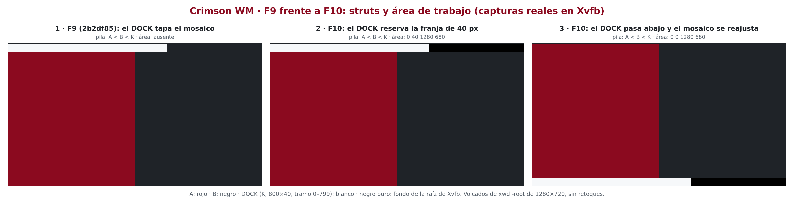

# Crimson WM

**Crimson WM: an experimental, safety-first tiling window manager for X11,
written in Rust (pre-alpha).**

Crimson WM is a small X11 window manager built incrementally, with each
phase documented in an architecture decision record (ADR) and verified by
automated tests in isolated Xvfb servers. It targets Debian 13 (Trixie) and
the Rust toolchain that Debian ships.

> [!WARNING]
> **Pre-alpha. Not ready for daily use.** Crimson WM has no mouse support,
> no configuration file and a fixed set of key bindings and programs. By
> design it **refuses to start on display `:0`** and only runs on test
> servers that pass its safeguards. Do not try to use it as your session's
> window manager.



*Authentic `xwd` captures from isolated 1280×720 Xvfb servers (acceptance
tests A118 and A119): panel 1 runs the F9 binary, panels 2 and 3 the F10
binary. Only labels were added.*

## Status

Phases F1–F10 are implemented and recorded. In the most recent recorded
runs (2026-10-14, Debian 13, debug build), all 139 unit tests passed and
every acceptance battery from F1 to F10 passed. In each battery, one check
is skipped on purpose because it would query the real display `:0`. One
F3 run failed once while preparing its Xvfb server and passed when
repeated; the cause has not been determined (see the technical
documentation). Results of specific runs are not a guarantee for later
changes; see the ADRs for details.

| Phase | Feature | Details |
|---|---|---|
| F1 | Safe connection to a test X server: rejects `:0`, TCP and malformed displays; requires a sandbox token and marker; refuses to run if another window manager is present | [ADR 0003](docs/adr/0003-salvaguardas-desarrollo.md) |
| F2 | Master-stack tiling: master column at 50%, stack on the right; dialogs float | [ADR 0004](docs/adr/0004-mosaico-master-stack.md) |
| F3 | Keyboard focus and navigation (`Mod4+j`/`k`, `Mod4+Shift+Return`), ICCCM input models | [ADR 0005](docs/adr/0005-foco-y-atajos.md) |
| F4 | Launching six fixed programs from key bindings, without a shell and with a sanitized environment | [ADR 0006](docs/adr/0006-lanzamiento-de-aplicaciones.md) |
| F5 | Eight virtual desktops (`Mod4+1…8`, `Mod4+Shift+1…8`, `Mod4+Tab`) | [ADR 0007](docs/adr/0007-escritorios-virtuales.md) |
| F6 | ICCCM/EWMH identification, cooperative close (`Mod4+w`), forced close (`Mod4+Shift+w`), validated EWMH requests, client lists | [ADR 0008](docs/adr/0008-compatibilidad-icccm-ewmh.md) |
| F7 | Fullscreen (`Mod4+f`, `_NET_WM_STATE_FULLSCREEN`) with geometry restore | [ADR 0009](docs/adr/0009-pantalla-completa.md) |
| F8 | Dialogs (`WM_TRANSIENT_FOR`): centred on their parent, kept above it, moved with it | [ADR 0010](docs/adr/0010-dialogos-transitorios.md) |
| F9 | EWMH window types; docks, notifications and desktop windows fixed on all desktops; stacking layers | [ADR 0011](docs/adr/0011-tipos-de-ventana-ewmh.md) |
| F10 | `_NET_WM_STRUT`, `_NET_WM_STRUT_PARTIAL` and `_NET_WORKAREA`: docks reserve screen edges, tiling uses the work area | [ADR 0012](docs/adr/0012-struts-y-area-de-trabajo.md) |

### Key bindings

| Binding | Action |
|---|---|
| `Mod4+j` / `Mod4+k` | Focus next / previous window |
| `Mod4+Shift+Return` | Make the focused window the master (or swap it with the second) |
| `Mod4+f` | Toggle fullscreen |
| `Mod4+w` | Ask the focused window to close (`WM_DELETE_WINDOW`) |
| `Mod4+Shift+w` | Force-close the focused client (`KillClient`: closes all of its windows) |
| `Mod4+1` … `Mod4+8` | Show that desktop |
| `Mod4+Shift+1` … `Mod4+Shift+8` | Send the focused window to that desktop |
| `Mod4+Tab` | Go back to the previous desktop |
| `Mod4+Return`, `Mod4+d`, `Mod4+e`, `Mod4+b`, `Mod4+n`, `Print` | Launch `kitty`, `rofi -show drun`, `thunar`, `firefox`, `kitty -e nvim`, `flameshot gui` |
| `Mod4+Shift+Escape` | Quit (provisional binding) |

The programs and bindings are hard-coded for now.

### Current limitations

- No mouse support: no click to focus, no moving or resizing with the
  pointer.
- One layout (master-stack at 50%); no borders, gaps or decorations.
- No configuration file; bindings and programs are fixed.
- One screen, read once at startup: no RandR or multi-monitor support.
- The work area is a single rectangle: space next to a partial dock is not
  used.
- No `_NET_WM_STATE_ABOVE`/`BELOW`, general sticky windows, application
  rules, scratchpads, IPC or command-line control.
- No compositor, panel or other desktop components.
- Log messages and the detailed documentation are in Spanish.

## Building

Crimson WM is developed and tested on Debian 13 with Debian's Rust
packages (rustc and cargo 1.85.1). The declared minimum supported Rust
version is 1.85, but only 1.85.1 is tested; rustup is not used (see
[ADR 0001](docs/adr/0001-toolchain.md)).

```sh
sudo apt install --no-install-recommends rustc cargo rustfmt rust-clippy gcc libc6-dev
cargo build --locked --bins --examples
```

`Cargo.lock` is versioned and all commands use `--locked`. The only direct
dependency is [x11rb](https://github.com/psychon/x11rb) 0.14 (see
[docs/dependencies.md](docs/dependencies.md)). `unsafe` code is forbidden in
the crate itself.

## Testing

Static checks and unit tests need no X server:

```sh
cargo fmt -- --check
cargo clippy --locked --all-targets -- -D warnings
cargo test --locked
```

If rustup is also installed, make sure these commands use Debian's
toolchain, for example with `env PATH=/usr/bin:/bin cargo …`.

### Acceptance tests in Xvfb

Each phase has an acceptance harness under `tests/acceptance/fN/`. Every
case starts its own Xvfb with `xvfb-run` (temporary cookie, no TCP),
places the sandbox marker, and runs the window manager with `env -i` and a
minimal environment. Its `PATH` is empty (F1–F3) or contains only fake
programs (since F4), so no real application is ever launched.

```sh
sudo apt install --no-install-recommends xvfb xauth x11-utils x11-apps \
    x11-xserver-utils xdotool imagemagick procps diffutils bsdextrautils shellcheck
tests/acceptance/f10/run.sh
```

Before starting any X server, each harness asks Cargo for the window
manager and test client (`cargo build --locked --offline`). Cargo rebuilds
them only if they are out of date, and the harness stops with exit code 2
if the build fails. Pass a binary path as the first argument to test that
binary as it is. If rustup is installed, run the harnesses with
`env PATH=/usr/bin:/bin` so that Cargo uses Debian's toolchain.

Each harness prints a result table and the temporary directory with its
logs. The exit code is 0 only if no check failed. The harnesses only
observe the real session with `pgrep`; they never connect to `:0`.

Some harnesses also produce comparison captures with a historical binary
built from `git archive` (optional `CRIMSON_F8_BIN` and `CRIMSON_F9_BIN`);
see the technical documentation.

## Safety and isolation

Crimson WM must never take over a real session by accident. Before it
manages anything, it checks, in order:

1. `DISPLAY` is a local Unix-socket display with a number other than 0;
   `:0` is always rejected, before connecting.
2. `CRIMSON_SANDBOX_TOKEN` is set, and the root window carries a matching
   `_CRIMSON_SANDBOX` marker.
3. No other window manager is running (`_NET_SUPPORTING_WM_CHECK`, the
   `WM_S0` selection, or `SubstructureRedirect` already taken).

These are **safeguards against accidents, not a security boundary**: any
client of an X server can affect the others. The details and exit codes
are in [ADR 0003](docs/adr/0003-salvaguardas-desarrollo.md). The supported
way to run Crimson WM today is through the acceptance harnesses.

## Diagrams and captures

All captures are real Xvfb dumps. Diagrams are technical drawings made from
the code (SVG sources in [docs/images](docs/images)).

- Master-stack layout: [diagram](docs/images/crimson-wm-master-stack.png),
  [capture](docs/images/crimson-wm-f2-captura-xvfb.png)
- Startup and event flow: [diagram](docs/images/crimson-wm-overview.svg)
- ICCCM/EWMH: [diagram](docs/images/crimson-wm-f6-icccm-ewmh.png)
- Fullscreen: [diagram](docs/images/crimson-wm-f7-fullscreen.png),
  [captures](docs/images/crimson-wm-f7-comparison.png)
- Dialogs: [diagram](docs/images/crimson-wm-f8-dialogs.png),
  [captures](docs/images/crimson-wm-f8-comparison.png)
- Window types and layers: [diagram](docs/images/crimson-wm-f9-window-types.png),
  [captures](docs/images/crimson-wm-f9-comparison.png)
- Struts and work area: [diagram](docs/images/crimson-wm-f10-workarea.png),
  [captures](docs/images/crimson-wm-f10-comparison.png)

## Documentation

- [Technical documentation (Spanish)](docs/README-technical-es.md): every
  phase in detail, requirements, harnesses and recorded results.
- [Architecture decision records (Spanish)](docs/adr/): ADR 0001–0012.
- [Dependency record](docs/dependencies.md).

## Roadmap

Planned work. None of the following is implemented yet:

- Mouse support (click to focus, moving and resizing floating windows).
- More layouts (for example monocle) and adjustable proportions.
- A declarative TOML configuration, fully validated before it is applied
  and reloadable, with configurable key bindings.
- Application and window rules; scratchpads.
- Multi-monitor support through RandR.
- IPC and a command-line tool to query and control the window manager.
- Visual testing with Xephyr.
- Separate, optional desktop components (panel, launcher, settings), never
  required by the window manager core.

## Contributing

Contributions are welcome once you have read [CONTRIBUTING.md](CONTRIBUTING.md).
Never test Crimson WM on your real X session. To report a security
problem, see [SECURITY.md](SECURITY.md).

## License

Crimson WM is licensed under either of

- Apache License, Version 2.0 ([LICENSE-APACHE](LICENSE-APACHE)), or
- MIT license ([LICENSE-MIT](LICENSE-MIT)),

at your option. Dependencies keep their own licenses (see
[docs/dependencies.md](docs/dependencies.md)).

Unless you explicitly state otherwise, any contribution intentionally
submitted for inclusion in the work by you, as defined in the Apache-2.0
license, shall be dual licensed as above, without any additional terms or
conditions.
