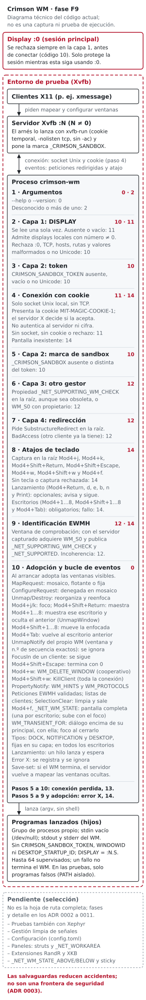

# Crimson WM

Gestor de ventanas para X11, escrito en Rust y dirigido inicialmente a
Debian 13 (Trixie). Su objetivo es la gestión de ventanas en mosaico, que
todavía no está implementada (ver «Estado»).

## Estado

Fase F1: prototipo del núcleo. **Todavía no es un gestor de ventanas
utilizable:** solo arranca en un servidor X de prueba que supere las
salvaguardas del ADR 0003, mapea y configura las ventanas tal como lo
piden y termina con el atajo provisional `Mod4+Shift+Escape`.

Las cuatro capas de salvaguardas están implementadas desde P4
(2026-10-11). Últimos resultados registrados en
`docs/adr/0003-salvaguardas-desarrollo.md`:

- Pruebas unitarias U1–U4 (18 pruebas de `cargo test`): pasaron.
- Pruebas de aceptación de F1, ejecutadas el 2026-10-12 en Xvfb sobre el
  binario de depuración: A1–A8 pasaron y **A9 quedó parcial**, porque la
  consulta de la raíz de `:0` se omitió deliberadamente. Detalles y
  limitaciones en «Resultados de las pruebas de aceptación de F1».

Son los resultados de esas ejecuciones concretas, no una garantía para
cambios posteriores: las pruebas deben repetirse tras cada cambio.

No ejecutes Crimson WM sobre una sesión gráfica real.

## Funcionamiento de F1



*Diagrama técnico elaborado a partir del código fuente y de los ADR 0002 y
0003. No es una captura ni demuestra una ejecución; los resultados de las
pruebas están en el ADR 0003.*

## Principios

- Núcleo pequeño y correcto antes que muchas funciones incompletas.
- Sin GTK ni otros componentes de escritorio como dependencia del núcleo.
- `unsafe` prohibido en el código propio (`unsafe_code = "forbid"`); el de
  las dependencias se auditará por separado (ver `docs/dependencies.md`).
- Configuración declarativa (TOML), validada por completo antes de
  aplicarse y con recarga transaccional.
- Atajos ejecutados como lista `argv`, nunca mediante una shell implícita.
- Sin reparenting ni compositor propio en la primera versión.

## Requisitos

### Paquetes Debian

| Paquete | Herramientas que aporta | Uso | Estado |
|---|---|---|---|
| `rustc`, `cargo`, `rustfmt`, `rust-clippy` (1.85.1) | `rustc`, `cargo`, `rustfmt`, `cargo clippy` | Compilación y análisis estático | Instalado |
| `gcc`, `binutils`, `libc6-dev` | `gcc`, `cc` (alternativa del sistema que apunta a `gcc`), `ld` | Enlazado (dependencias de `rustc`; enlazador por defecto pendiente de confirmar al compilar) | Instalado |
| `xvfb` | `Xvfb`, `xvfb-run` | Servidor X sin pantalla para pruebas automatizadas | Instalado |
| `xauth` | `xauth` | Cookies de autenticación de los servidores de prueba | Instalado |
| `util-linux` | `mcookie`, `unshare` | Valores aleatorios para cookies y marca de sandbox; aislamiento sin privilegios de A1, A2 y A3a | Instalado |
| `bsdextrautils` | `column` | Tabla de resultados del arnés de aceptación | Instalado |
| `x11-utils` | `xprop`, `xwininfo`, `xmessage`, `xlsatoms` | Clientes y comprobaciones de prueba | Instalado |
| `xdotool` | `xdotool` | Simulación de teclado en pruebas | Instalado |
| `procps` | `pgrep` | Comprobación de procesos | Instalado |
| `shellcheck` | `shellcheck` | Análisis de los scripts de prueba | Instalado |
| `bash`, `coreutils`, `findutils`, `grep`, `mawk`, `mount` | `bash`, `timeout`, `mktemp`, `find`, `grep`, `awk`, `mount` | Ejecución del arnés de aceptación | Instalado (paquetes base) |
| `xserver-xephyr` | `Xephyr` | Pruebas visuales | **Aplazado** (no instalado) |

### Herramientas opcionales o futuras

| Herramienta | Uso | Estado |
|---|---|---|
| `cargo-deny`, `cargo-audit` | Licencias y avisos de seguridad de dependencias | Aplazadas hasta que el árbol de dependencias lo justifique |
| `ss` (`iproute2`) | Posible comprobación adicional de a qué servidor se conecta el WM (`ss -xp`, ver ADR 0003). Ningún script del arnés actual la usa | Instalada; pendiente de validar |

No se usa rustup. Ver `docs/adr/0001-toolchain.md`.

## Pruebas

Las pruebas se ejecutan **solo** sin servidor X o en servidores X de
prueba aislados; ninguna se conecta con la sesión principal.

### Unitarias (U1–U4)

```sh
cargo test --locked
```

### Aceptación de F1 (A1–A9)

```sh
cargo build --locked
tests/acceptance/f1/run.sh [BINARIO]
```

- Sin argumento usa `target/debug/crimson-wm` y exige que sea más reciente
  que `src/`, `Cargo.toml` y `Cargo.lock`. Con un argumento usa ese
  binario, sin esa comprobación.
- Se niega a ejecutarse como root y, antes de empezar, comprueba que
  estén disponibles las órdenes de prueba que no pertenecen a los paquetes
  base, además de `timeout`.
- A1, A2 y A3a se ejecutan con `unshare -rmn`, sin ningún servidor X
  visible, así que el núcleo debe permitir espacios de nombres de usuario
  sin privilegios.
- Las demás se ejecutan cada una en un Xvfb nuevo lanzado por `xvfb-run`
  (ver «Servidores de prueba»).
- La sesión principal solo se observa con `pgrep` (por defecto, `bspwm` y
  `sxhkd`; se puede cambiar con `CRIMSON_F1_WATCH`). La consulta de la
  raíz de `:0` se omite deliberadamente, así que A9 queda siempre parcial.
- Los resultados se guardan en un directorio nuevo `crimson-f1.XXXXXX`
  dentro de `$TMPDIR` (o de `/tmp` si no está definida o está vacía), que
  se indica al final. El arnés no lo borra.

Código de salida: 0 si ninguna comprobación falla ni falta; 1 si alguna
falla, falta o está duplicada; 2 si no se pudo preparar la ejecución
(root, órdenes que faltan, binario ausente o anterior a las fuentes, o
fallo de `mktemp` al crear el directorio de resultados). Las comprobaciones
omitidas no cuentan como fallo: un 0 no significa que A9 esté completa.

### Servidores de prueba

- **Xvfb**, mediante `xvfb-run -a`. Según `/usr/bin/xvfb-run` en Debian 13,
  esta orden elige un display libre a partir de `:99`, genera una cookie
  temporal con `mcookie` y `xauth` en un directorio `xvfb-run.XXXXXX` de
  `$TMPDIR` (o de `/tmp`), arranca Xvfb con `-auth` y añade `-nolisten tcp`
  por defecto. También fija `DISPLAY` y `XAUTHORITY` para la orden que
  ejecuta y detiene el servidor al terminar. El arnés pasa al servidor
  `-screen 0 1280x720x24 -nolisten tcp` (la repetición de `-nolisten tcp`
  es una defensa explícita). Nunca se usará `--listen-tcp`.
- **Xephyr**, más adelante, siempre con `-auth` y `-nolisten tcp`.

Nunca se usará `-ac`, que desactiva el control de acceso de X11.

Salvaguardas (detalle en `docs/adr/0003-salvaguardas-desarrollo.md`):
solo displays locales por socket Unix; rechazo incondicional del display
número 0; marca de sandbox `_CRIMSON_SANDBOX`; y rechazo si ya hay otro
gestor de ventanas (`_NET_SUPPORTING_WM_CHECK` o `BadAccess`). Son
**salvaguardas contra accidentes, no una frontera de seguridad.**

## Documentación

- `docs/adr/0001-toolchain.md`: toolchain, MSRV y `Cargo.lock`.
- `docs/adr/0002-x11rb.md`: biblioteca X11 y garantías de `unsafe`.
- `docs/adr/0003-salvaguardas-desarrollo.md`: protección de la sesión
  principal y códigos de salida.
- `docs/dependencies.md`: registro de dependencias y auditorías.

## Volver al estado anterior

Todo el proyecto vive en `~/Proyectos/crimson-wm/`. Fuera de él solo
existen (o existirán):

- Los paquetes de la toolchain, instalados con
  `sudo apt install --no-install-recommends rustc cargo rustfmt rust-clippy`.
  Se retiran con
  `sudo apt remove rustc cargo rustfmt rust-clippy libstd-rust-dev libstd-rust-1.85`.
- La caché de Cargo en `~/.cargo/`, creada al descargar las dependencias.
  Antes de borrarla, comprueba que ningún otro proyecto la utilice.
- Los servidores de prueba y sus archivos temporales. `xvfb-run`, o el
  script de Xephyr, elimina el servidor, la cookie y el directorio temporal
  cuando **él** termina. Tras una interrupción forzada (por ejemplo,
  SIGKILL) pueden quedar el proceso del servidor, `$TMPDIR/xvfb-run.*` (o
  `/tmp/xvfb-run.*`), `/tmp/.X<N>-lock` y `/tmp/.X11-unix/X<N>`. Esos
  archivos se pueden borrar después de comprobar con `pgrep -a Xvfb` (o
  `pgrep -a Xephyr`) que no queda ningún servidor en ese display.
- Los resultados de las pruebas de aceptación, en `$TMPDIR/crimson-f1.*`
  (o `/tmp/crimson-f1.*`). El arnés no los borra; se pueden eliminar cuando
  ya no se necesiten. Los espacios de nombres de `unshare` y el tmpfs que
  se monta dentro desaparecen al terminar.

Nada de esto modifica la sesión bspwm + sxhkd, sus configuraciones, el
gestor de inicio ni los archivos de sesión.

## Licencia

Pendiente de decisión del autor.
