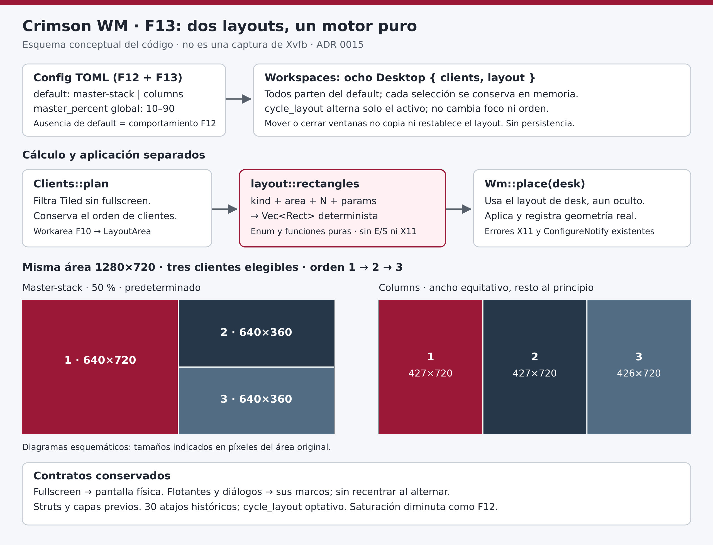
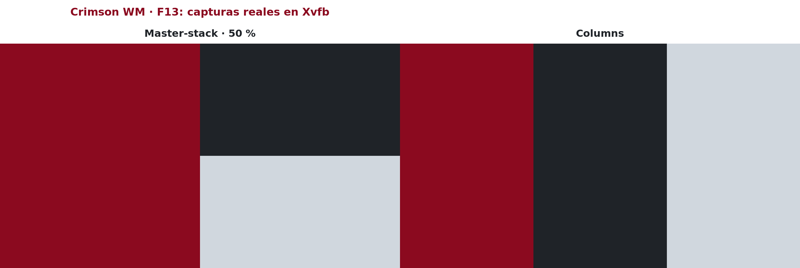
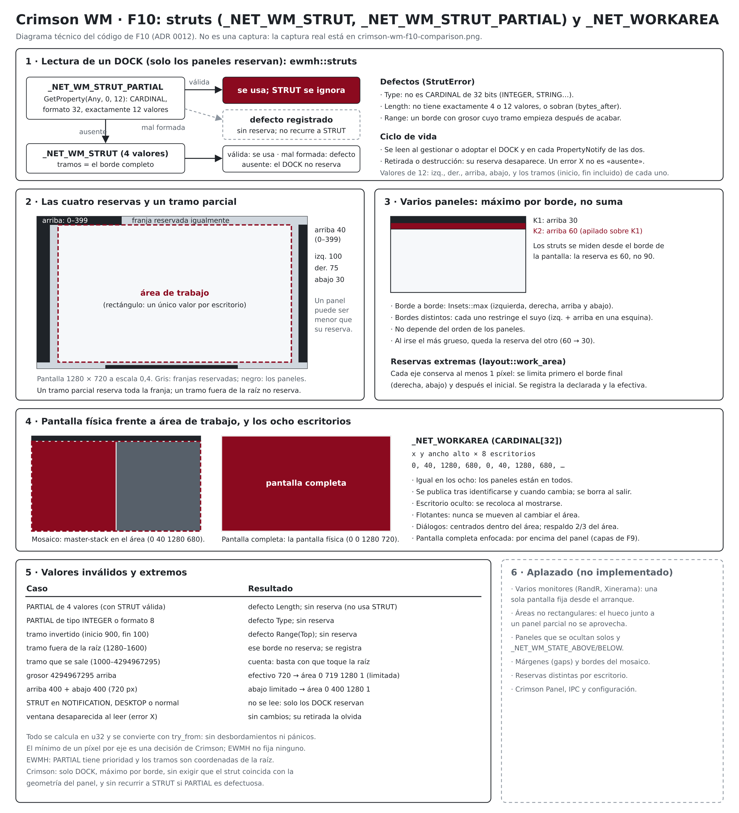
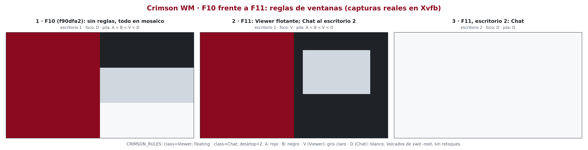
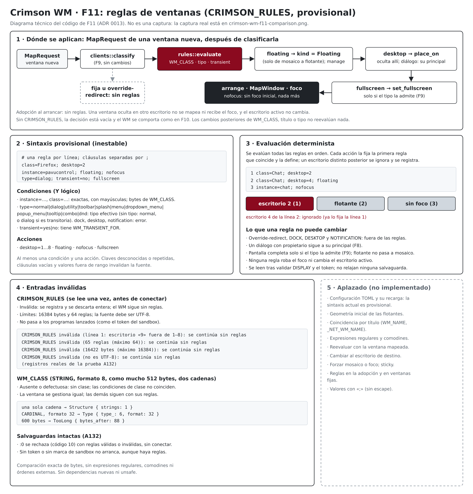
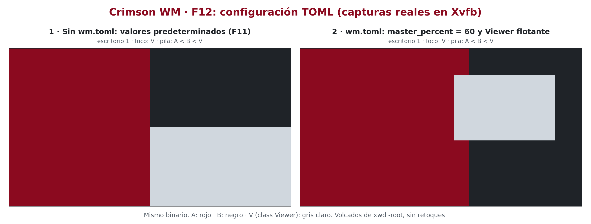
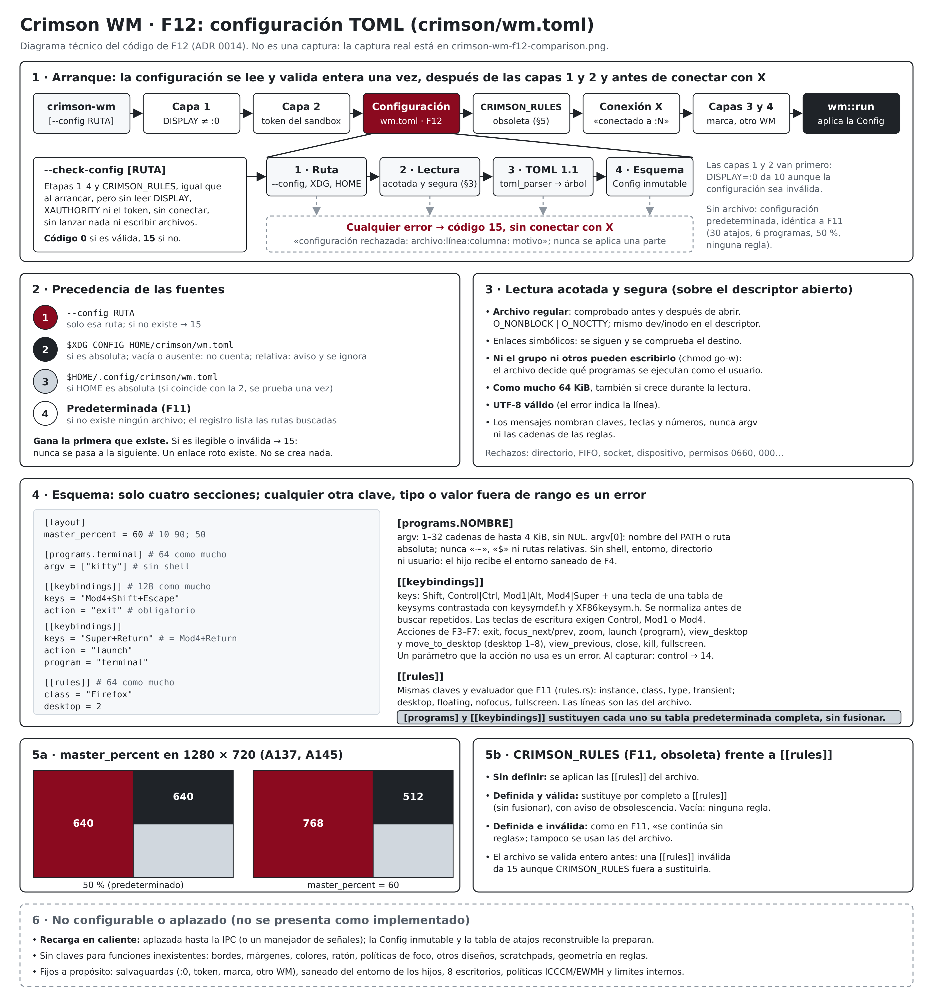

# Crimson WM: documentación técnica (español)

> Este documento conserva la documentación técnica detallada de las fases
> F1–F13, con sus resultados de pruebas. La presentación pública del
> proyecto, en inglés, está en el [README](../README.md) del repositorio.
> Las órdenes se ejecutan desde la raíz del repositorio.

Gestor de ventanas para X11, escrito en Rust y dirigido inicialmente a
Debian 13 (Trixie), orientado a la gestión de ventanas en mosaico. Por ahora
es un prototipo con Master-stack y Columns, ocho escritorios
virtuales, pantalla completa, diálogos que siguen a su ventana principal,
tipos de ventana EWMH con paneles y fondos fijos en todos los escritorios,
paneles que reservan espacio en los bordes y compatibilidad parcial con
ICCCM y EWMH (ver «Estado»).

## Estado

Fase F13: motor puro de layouts y selección por escritorio, sobre la
configuración TOML (`crimson/wm.toml`), las reglas de
ventanas, los struts y el área de trabajo, los tipos de ventana EWMH,
las ventanas fijas y las capas de apilamiento, los diálogos y ventanas transitorias, la
pantalla completa, la compatibilidad ICCCM/EWMH, los escritorios virtuales,
el lanzamiento de aplicaciones, el foco por teclado y el mosaico
master-stack. **Todavía no es un gestor de ventanas utilizable:** solo
arranca en un servidor X de prueba que supere las salvaguardas del ADR
0003, coloca las ventanas normales en mosaico, deja flotantes los diálogos
y los mantiene con su ventana principal, deja paneles, avisos y fondos
fijos en su capa y en todos los escritorios, deja que los paneles reserven
su borde, aplica reglas por `WM_CLASS`, tipo y transitoriedad, gestiona el
foco con el teclado,
reparte las ventanas en ocho escritorios, pone una ventana a pantalla
completa, cierra ventanas, lanza programas sin shell y termina con un
atajo de salida. Sus atajos, programas, layout inicial, proporción de la maestra y reglas
se pueden configurar en un archivo TOML validado al arrancar; sin él, se
comporta como F11. No tiene ratón, decoraciones, panel propio, varios
monitores ni recarga de la configuración.

Las cuatro capas de salvaguardas están implementadas desde P4
(2026-10-11). La [auditoría F13-C](f13-audit.md) registra 214 unitarias,
166 OK de F13 y las doce regresiones F1–F12 sin fallos, cada aceptación
con una omisión deliberada por `:0`. Incluye las correcciones de los
observadores y la investigación de Xvfb. Los antecedentes de F13-B se
conservan en el [ADR 0015](adr/0015-motor-de-layouts.md). Antecedentes de F12-C,
todos del 2026-10-15 en Xvfb
sobre el binario de depuración de F12 (detalles y limitaciones en los ADR
0003 a 0014):

- Pruebas unitarias U1–U24 y regresiones de F12-C (204 pruebas de
  `cargo test`): pasaron; ver [auditoría F12-C](f12-audit.md).
- Aceptación de F12: A136–A148 pasaron y **A149 quedó parcial**, porque la
  consulta de la raíz de `:0` se omite deliberadamente (187 OK, 0 FALLA,
  1 OMITIDA). Solo se lanzaron programas falsos, nunca las aplicaciones
  reales.
- Regresión de F11: A121–A134 pasaron y **A135 quedó parcial** por el
  mismo motivo.
- Regresión de F10: A104–A119 pasaron y **A120 quedó parcial** por el
  mismo motivo.
- Regresión de F9: A88–A102 pasaron y **A103 quedó parcial** por el mismo
  motivo.
- Regresión de F8: A76–A86 pasaron y **A87 quedó parcial** por el mismo
  motivo.
- Regresión de F7: A63 y A65–A74 pasaron y **A75 quedó parcial** por el
  mismo motivo.
- Regresión de F6: A53–A62 y el caso A64 pasaron; las comprobaciones de
  sesión de **A64 quedaron parciales** por el mismo motivo.
- Regresión de F5: A41–A51 pasaron y **A52 quedó parcial** por el mismo
  motivo.
- Regresión de F4: A33–A39 pasaron y **A40 quedó parcial** por el mismo
  motivo.
- Regresión de F3: A22–A31 pasaron y **A32 quedó parcial** por el mismo
  motivo.
- Regresión de F2: A10–A20 pasaron y **A21 quedó parcial** por el mismo
  motivo.
- Regresión de F1: A1–A8 pasaron y **A9 quedó parcial** por el mismo
  motivo.

Son los resultados de esas ejecuciones concretas, no una garantía para
cambios posteriores: las pruebas deben repetirse tras cada cambio.

No ejecutes Crimson WM sobre una sesión gráfica real.

## Motor de layouts (F13)

`LayoutKind` enumera exclusivamente Master-stack y Columns. El motor
`layout::rectangles` recibe un área normalizada, el número de clientes y
parámetros validados; devuelve rectángulos deterministas sin X11 ni E/S.
`Clients::plan` conserva el filtro de elegibles y `Wm::place(desk)` aplica
el algoritmo del escritorio recibido, incluso si está oculto.

Cada uno de los ocho escritorios conserva en memoria su selección. Todos
empiezan con `[layout] default = "master-stack"` (también admite
`"columns"`). El porcentaje de maestra sigue siendo global; Columns no lo
usa, pero se valida igualmente. Omitir `default` conserva F12.

`cycle_layout` alterna ambos algoritmos solo en el activo, sin cambiar
foco, orden, reglas ni fullscreen. No tiene atajo predeterminado: se
conservan los 30 históricos. Una tabla explícita sigue sustituyendo la
tabla completa. No hay persistencia ni recarga.



*Diagrama conceptual del código, no captura. Fuente editable
[SVG](images/crimson-wm-f13-layouts.svg).*



*Capturas auténticas de A151, tomadas con `xwd` en Xvfb aislado 1280×720.
Mismo binario y mismos clientes. Solo se añaden rótulos; ambos paneles se
contrastan píxel a píxel con los originales.*

Columns reparte W/N y entrega el resto a las primeras ventanas. Para W=1280
y N=3: anchos 427, 427, 426. Cuando N>W, los sobrantes se solapan en el
último píxel, conservando la política de saturación histórica. Fullscreen
usa la pantalla física; flotantes y diálogos conservan sus marcos. Los
struts se aplican antes de calcular el mosaico. Detalles y límites en el
[ADR 0015](adr/0015-motor-de-layouts.md).

## Diseño master-stack (F2)


*Ilustración conceptual, no una captura. Fuente editable:
`docs/images/crimson-wm-master-stack.svg`.*

- La primera ventana ocupa el área master, la mitad izquierda. Las demás,
  en orden de llegada, se reparten la altura de la mitad derecha.
- Al abrir, cerrar o desmapear una ventana, el mosaico se reorganiza. Si se
  cierra la maestra, la siguiente ocupa su lugar; una ventana que vuelve a
  mapearse entra al final.
- Los diálogos y las ventanas transitorias quedan flotantes, por encima del
  mosaico, con el tamaño que piden. Desde F8, cada diálogo se centra sobre
  su ventana principal salvo que pida una posición (ver «Diálogos»).
- Una ventana en mosaico no puede cambiar su posición ni su tamaño: el WM
  deniega la petición y le comunica su geometría real (ICCCM).
- Sin bordes ni márgenes, y con una proporción fija del 50 %.

Detalles, casos límite y limitaciones en el ADR 0004.


*Captura de prueba tomada con `xwd` en un Xvfb aislado de 1280 × 720, con
Crimson WM F2 en marcha: `xlogo` como maestra, y `xclock` y `xeyes` en la
pila. No es una sesión de escritorio. El negro alrededor de los ojos es la
raíz del servidor: `xeyes` usa una ventana con forma.*

## Foco y atajos (F3)

| Atajo | Acción |
|---|---|
| `Mod4+j` / `Mod4+k` | Enfoca la ventana siguiente o anterior: primero el mosaico (maestra y pila de arriba abajo) y después las flotantes, con vuelta al principio |
| `Mod4+Shift+Return` | La ventana enfocada pasa a maestra; si ya lo es, se intercambia con la segunda |
| `Mod4+Shift+Escape` | Termina el WM (atajo provisional) |
| `Mod4+w` | Pide a la ventana enfocada que se cierre (`WM_DELETE_WINDOW`; desde F6) |
| `Mod4+Shift+w` | Cierra a la fuerza el cliente de la ventana enfocada: **todas** sus ventanas (`KillClient`; desde F6) |
| `Mod4+f` | Alterna la pantalla completa de la ventana enfocada (desde F7) |

Combinaciones reservadas para fases posteriores, **todavía sin implementar
ni capturar**: `Mod4+h` y `Mod4+l` (foco a izquierda y derecha). Las de
aplicaciones se implementaron en F4 (ver «Lanzamiento de aplicaciones») y
las de cierre en F6 (ver «Compatibilidad ICCCM/EWMH»). Desde F5, el foco,
la navegación y el Zoom son por escritorio (ver «Escritorios virtuales»).

- Una ventana nueva recibe el foco al abrirse, salvo los paneles, avisos,
  menús y similares, que nunca lo reciben.
- Al cerrarse o desmapearse la ventana enfocada, el foco vuelve a la usada
  justo antes; al cerrar un diálogo, a su ventana principal.
- El foco respeta los modelos de entrada de ICCCM (incluido el mensaje
  `WM_TAKE_FOCUS`), y el WM sigue los cambios de foco que hacen los propios
  clientes.
- La ventana activa se publica en `_NET_ACTIVE_WINDOW`; desde F6 el soporte
  EWMH está declarado y las herramientas la leen.

Detalles, casos límite y limitaciones en el ADR 0005.

## Lanzamiento de aplicaciones (F4)

| Atajo | Programa |
|---|---|
| `Mod4+Return` | `kitty` |
| `Mod4+d` | `rofi -show drun` |
| `Mod4+e` | `thunar` |
| `Mod4+b` | `firefox` |
| `Mod4+n` | `kitty -e nvim` |
| `Print` | `flameshot gui` |

- La tabla es fija hasta la fase de configuración. Cada programa se
  ejecuta con su lista `argv`, sin shell ni expansión, buscándolo en el
  `PATH` del WM.
- Lanzar no bloquea el WM: un hilo lanza el programa y lo espera, así que
  no quedan procesos zombis. Como máximo hay 64 programas supervisados a la
  vez.
- Si el programa no existe o no se puede ejecutar, el error se registra y
  el WM sigue. Si falta la tecla de un atajo de lanzamiento, el WM avisa y
  arranca sin él.
- Una tecla mantenida o una doble pulsación en menos de 300 ms lanza un
  solo programa.
- Cada programa recibe el `DISPLAY` del servidor que gestiona el WM, sin
  `CRIMSON_SANDBOX_TOKEN`, `WINDOWID` ni `DESKTOP_STARTUP_ID`, con la
  entrada desde `/dev/null`, en su propio grupo de procesos y con `HOME`
  como directorio de trabajo. Sigue en marcha cuando el WM termina.

Detalles, casos límite y limitaciones en el ADR 0006.

## Escritorios virtuales (F5)

| Atajo | Acción |
|---|---|
| `Mod4+1` … `Mod4+8` | Muestra ese escritorio y enfoca su ventana más reciente |
| `Mod4+Shift+1` … `Mod4+Shift+8` | Lleva la ventana enfocada a ese escritorio, sin cambiar al destino |
| `Mod4+Tab` | Vuelve al escritorio anterior; repetido, alterna entre los dos |

- Cada escritorio tiene sus propias ventanas, su mosaico master-stack y su
  historial de foco; `Mod4+j`, `Mod4+k` y `Mod4+Shift+Return` solo actúan
  en el activo. Cambiar al escritorio activo no hace nada.
- Las ventanas nuevas aparecen en el escritorio activo; desde F8, un
  diálogo va al de su ventana principal (ver «Diálogos»). Al arrancar, las ventanas existentes van al escritorio 1.
- Las ventanas de los demás escritorios se ocultan (se desmapean): sus
  aplicaciones siguen en marcha. Una ventana oculta que pide mostrarse sigue
  oculta, sin cambiar de escritorio ni robar el foco.
- Si el WM termina por cualquier motivo, también con `SIGTERM` o `SIGKILL`,
  el servidor vuelve a mostrar las ventanas ocultas (save-set de X11); las
  que sus aplicaciones habían retirado no reaparecen.
- Se publican `WM_STATE` (normal u oculta), `_NET_NUMBER_OF_DESKTOPS`,
  `_NET_CURRENT_DESKTOP` y `_NET_WM_DESKTOP` como compatibilidad parcial: el
  WM no declara soporte EWMH ni atiende los mensajes de los pagers.
- Un solo monitor, sin ventanas en todos los escritorios (sticky) ni
  escritorios dinámicos.

Detalles, casos límite y limitaciones en el ADR 0007.

## Compatibilidad ICCCM/EWMH (F6)


*Diagrama técnico elaborado a partir del código de F6; no es una captura.
Fuente editable: `docs/images/crimson-wm-f6-icccm-ewmh.svg`.*

- **Identificación:** solo después de superar las salvaguardas, el WM crea
  una ventana de comprobación y, con el servidor capturado, adquiere la
  selección `WM_S0` y publica `_NET_SUPPORTING_WM_CHECK` y `_NET_SUPPORTED`.
  Así lo reconocen paneles, lanzadores y xdotool.
- **Salvaguardas:** si ya hay otro gestor (la propiedad, aunque sea
  obsoleta, o `WM_S0` con propietario), el WM no arranca (código 12). Si
  otro cliente le quita `WM_S0`, termina sin intentar recuperarla. Tras
  `SIGTERM` o `SIGKILL` la propiedad queda obsoleta y el siguiente arranque
  en ese servidor se rechaza hasta borrarla a mano
  (`xprop -root -remove _NET_SUPPORTING_WM_CHECK`, solo en el servidor de
  prueba).
- **Lo que se declara:** listas de ventanas (`_NET_CLIENT_LIST` y
  `_NET_CLIENT_LIST_STACKING`), ventana activa, escritorios, cierre y los
  tipos de ventana normal, diálogo, utilidad y barra de herramientas. Nada
  más en F6. Desde F7 se declara la pantalla completa y desde F9 los tipos
  splash, menú, panel (`DOCK`), escritorio (`DESKTOP`) y aviso (ver «Tipos
  de ventana»). Los paneles con espacio reservado, las ventanas sticky y
  otras funciones siguen pendientes.
- **Peticiones externas:**
  - un paginador puede cambiar de escritorio y enfocar una ventana;
  - una aplicación solo puede enfocar ventanas del escritorio activo;
  - se pueden mover ventanas entre los ocho escritorios;
  - el cierre por petición es siempre cooperativo: una aplicación que no
    admite `WM_DELETE_WINDOW` nunca se termina a la fuerza por una petición
    externa.
- `WM_TAKE_FOCUS` lleva siempre una marca de tiempo real, y los cambios de
  `WM_HINTS` y `WM_PROTOCOLS` se tienen en cuenta.

Detalles, casos límite y limitaciones en el ADR 0008.

## Pantalla completa (F7)


*Captura auténtica de Crimson WM en un Xvfb aislado de 1280 × 720 (prueba
A74): volcados de `xwd -root` sin retoques. Los paneles 1 y 3 son idénticos
píxel a píxel.*

- `Mod4+f` alterna la pantalla completa de la ventana enfocada. Las
  aplicaciones pueden pedirla con `_NET_WM_STATE` (añadir, quitar o
  alternar), también antes de mostrar su ventana.
- **En mosaico:** la ventana sale temporalmente del master-stack, y las
  demás se reparten el espacio detrás. Al salir recupera su hueco y el
  orden no cambia.
- **Flotante:** al salir recupera exactamente su posición, tamaño y borde.
- **Pila:** la ventana sube cuando tiene el foco. Si se enfoca otra de su
  escritorio, baja para que esa se vea; desde F8, si es un diálogo suyo,
  sigue arriba con el diálogo encima.
- **Escritorios:**
  - como mucho una ventana a pantalla completa por escritorio: la última
    petición gana;
  - el estado viaja con la ventana al moverla;
  - una petición para una ventana de otro escritorio no cambia el
    escritorio activo ni el foco.
- **Salida:**
  - al salir normalmente, todas las ventanas recuperan su geometría;
  - tras `SIGTERM` o `SIGKILL` no hay restauración, y una ventana flotante
    puede volver con un tamaño de respaldo (centrada, 2/3 de la pantalla).
- El WM solo gestiona el estado `FULLSCREEN`: conserva, sin
  interpretarlos, los demás estados que ponga la aplicación.


*Diagrama técnico elaborado a partir del código de F7; no es una captura.
Fuente editable: `docs/images/crimson-wm-f7-fullscreen.svg`.*

Detalles, casos límite y limitaciones en el ADR 0009.

## Diálogos (F8)


*Captura auténtica de Crimson WM en un Xvfb aislado de 1280 × 720 (prueba
A86): volcados de `xwd -root` sin retoques. Los rótulos de foco y pila se
leyeron del servidor en cada momento.*

- Un diálogo (`WM_TRANSIENT_FOR`) aparece **centrado sobre su ventana
  principal** y encima de ella, salvo que la aplicación pida una posición.
- **Escritorio:** va al de su principal. Si ese escritorio no está a la
  vista, el diálogo espera allí oculto, sin cambiar de escritorio ni quitar
  el foco.
- **Mover** una ventana a otro escritorio se lleva sus diálogos; mover un
  diálogo se lleva los suyos.
- **Al cerrar** un diálogo, el foco vuelve a su ventana principal si
  sigue en el mismo escritorio.
- **Pantalla completa:** si la ventana a pantalla completa abre un diálogo,
  este queda encima y visible.
- **Valores inválidos** (la raíz, la propia ventana, una ventana
  desconocida o un ciclo): la ventana queda como una flotante normal, y el
  WM registra el motivo.
- Aún no hay diálogos modales ni grupos de ventanas.


*Diagrama técnico elaborado a partir del código de F8; no es una captura.
Fuente editable: `docs/images/crimson-wm-f8-dialogs.svg`.*

Detalles, casos límite y limitaciones en el ADR 0010.

## Tipos de ventana (F9)


*Capturas auténticas en Xvfb aislados de 1280 × 720 (pruebas A101 y A102):
el primer panel con el binario de F8 (commit 195938d), los otros dos con
el de F9. Volcados de `xwd -root` sin retoques; los rótulos de foco y pila
se leyeron del servidor.*

- **Clasificación:** cuenta el primer tipo reconocido de
  `_NET_WM_WINDOW_TYPE`. Sin tipo reconocido, una ventana transitoria es un
  diálogo y las demás van al mosaico, como antes.
- **`DOCK` y `NOTIFICATION`:** ventanas fijas, visibles en todos los
  escritorios, por encima del mosaico y de las flotantes, sin foco y fuera
  de `Mod4+j`/`Mod4+k`.
- **`DESKTOP`:** ventana fija, siempre por debajo del mosaico.
- **Menús, tooltips y splash gestionados:** flotantes, sin foco y en la
  posición que piden, aunque sean transitorios.
- **Pantalla completa:** solo ventanas normales, diálogos, utilidades,
  barras de herramientas y ventanas sin tipo. Con el foco queda por encima
  del panel; sin él, por encima del fondo.
- **Capas**, de abajo arriba: `DESKTOP`, mosaico, flotantes, `DOCK` y
  `NOTIFICATION`, y la pantalla completa enfocada.
- **Un cambio de tipo** con la ventana ya visible se ignora hasta que la
  aplicación la retire y la vuelva a mostrar.
- **Aún no:** no hay `_NET_WM_STATE_ABOVE`/`BELOW` ni ventanas sticky
  generales, ni Crimson Panel. Desde F10 los paneles sí reservan espacio
  (ver «Struts y área de trabajo»).


*Diagrama técnico elaborado a partir del código de F9; no es una captura.
Fuente editable: `docs/images/crimson-wm-f9-window-types.svg`.*

Detalles, casos límite y limitaciones en el ADR 0011.

## Struts y área de trabajo (F10)


*Capturas auténticas en Xvfb aislados de 1280 × 720 (pruebas A118 y A119):
el primer panel con el binario de F9 (commit 2b2df85), los otros dos con
el de F10. Volcados de `xwd -root` sin retoques; los rótulos de pila y
área se leyeron del servidor.*

- **Reservas:** un panel (`DOCK`) puede reservar su borde con
  `_NET_WM_STRUT_PARTIAL` o, si no la tiene, con `_NET_WM_STRUT`. Las demás
  ventanas no reservan nada.
- **Mosaico:** usa el área de trabajo, la pantalla menos las reservas, y se
  reajusta cuando un panel aparece, cambia su reserva o desaparece. Las
  ventanas flotantes no se mueven.
- **Varios paneles:** en cada borde cuenta la reserva mayor, no la suma.
- **Pantalla completa:** ocupa la pantalla entera, también bajo los
  paneles. Los diálogos nuevos se centran dentro del área de trabajo.
- **`_NET_WORKAREA`:** el área de trabajo, igual en los ocho escritorios.
  Se borra al salir.
- **Valores defectuosos o excesivos:** se registran y no reservan nada, o se
  limitan para que siempre quede al menos un píxel en cada eje. Si
  `_NET_WM_STRUT_PARTIAL` es defectuosa, no se usa `_NET_WM_STRUT` en su
  lugar.
- **Aún no:** varios monitores, áreas no rectangulares (el hueco junto a un
  panel parcial no se aprovecha), márgenes ni Crimson Panel.



*Diagrama técnico elaborado a partir del código de F10; no es una
captura. Fuente editable: `docs/images/crimson-wm-f10-workarea.svg`.*

Detalles, casos límite y limitaciones en el ADR 0012.

## Reglas de ventanas (F11)



*Capturas auténticas en Xvfb aislados de 1280 × 720 (pruebas A133 y A134):
el primer panel con el binario de F10 (commit f90dfa2), los otros dos con
el de F11, con las mismas reglas. Volcados de `xwd -root` sin retoques.*

- **Fuente provisional:** la variable `CRIMSON_RULES`, leída una vez al
  arrancar. **Su sintaxis es inestable**; la sustituirá una configuración
  TOML.
- **Formato:** una regla por línea, con cláusulas separadas por `;`; las
  líneas vacías y los comentarios `#` se ignoran.

  ```text
  class=Firefox; desktop=2
  instance=pavucontrol; floating; nofocus
  type=dialog; transient=no; fullscreen
  ```

- **Condiciones** (se combinan con Y lógico, exactas y sensibles a
  mayúsculas): `instance=` y `class=` (las dos cadenas de `WM_CLASS`),
  `type=` (el tipo EWMH efectivo) y `transient=yes|no`.
- **Acciones:**
  - `desktop=1…8`: la ventana espera oculta allí, sin cambiar el escritorio
    activo ni el foco;
  - `floating`;
  - `nofocus`: solo evita el foco inicial;
  - `fullscreen`: solo para los tipos que la admiten.
- **Prioridad:** se evalúan todas las reglas en orden, y cada acción la
  fija la primera regla que coincide y la define.
- **Fuera de las reglas:** las ventanas adoptadas al arrancar, las
  override-redirect, los paneles, los avisos y los fondos. Un diálogo con
  propietario sigue siempre en el escritorio de su principal.
- **Sin reevaluación:** cambiar después `WM_CLASS`, el título o el tipo no
  vuelve a aplicar las reglas.
- **Errores:**
  - una fuente inválida se descarta entera y el WM arranca sin reglas,
    después de registrarlo;
  - un `WM_CLASS` defectuoso no coincide con ninguna regla;
  - las salvaguardas no cambian.
- **Aún no:** geometría inicial, títulos, comodines, expresiones regulares,
  TOML ni valores con `;`.



*Diagrama técnico elaborado a partir del código de F11; no es una captura.
Fuente editable: `docs/images/crimson-wm-f11-rules.svg`.*

Detalles, casos límite y limitaciones en el ADR 0013. Desde F12, las
mismas reglas se escriben en `[[rules]]` del archivo de configuración, y
`CRIMSON_RULES` queda obsoleta (ver la sección siguiente).

## Configuración TOML (F12)



*Capturas auténticas en Xvfb aislados de 1280 × 720 (pruebas A147 y A148),
con el mismo binario de F12: sin archivo de configuración y con
`master_percent = 60` y una regla. Volcados de `xwd -root` sin retoques.*

- **Archivo:** `crimson/wm.toml`, leído **una vez**, después de las capas
  1 y 2 y **antes de conectar con X**. Sin recarga en caliente.
- **Precedencia:** `--config RUTA` (única fuente; debe existir) >
  `$XDG_CONFIG_HOME/crimson/wm.toml` (si es una ruta absoluta; si es
  relativa, se ignora con un aviso; ausente o vacía, no cuenta) >
  `$HOME/.config/crimson/wm.toml` > configuración predeterminada, idéntica
  a F11. Gana el primer archivo que existe; si es ilegible o inválido, no
  se pasa al siguiente. No se crea ningún archivo.
- **Lectura segura:** archivo regular (comprobado antes de abrir y sobre
  el descriptor), destino de los enlaces, sin escritura para el grupo ni
  otros, 64 KiB como mucho, UTF-8. F12-C añade apertura no bloqueante para
  rechazar también una sustitución por FIFO sin bloquear el arranque.
- **Esquema:** `[layout] master_percent` (10–90), `[programs.NOMBRE]` con
  `argv` (sin shell, `~` ni `$`), `[[keybindings]]` (`keys`, `action`,
  `program`, `desktop`) y `[[rules]]` (las claves de F11). Claves
  desconocidas, tipos, rangos, duplicados normalizados y la falta de un
  atajo `exit` son errores. `[[keybindings]]` y `[programs]` sustituyen
  cada uno su tabla predeterminada completa.
- **Errores:** código de salida **15**, con archivo, línea y columna, antes
  de conectar; nunca se aplica una parte. Los mensajes no reproducen argv
  ni las cadenas de las reglas.
- **`--check-config [RUTA]`:** valida igual que el arranque, sin `DISPLAY`,
  `XAUTHORITY`, token ni servidor X; código 0 o 15.
- **`CRIMSON_RULES`** (obsoleta): si está definida, sustituye a las
  `[[rules]]` del archivo con un aviso; si es inválida, el WM arranca sin
  reglas, como en F11.
- **Dependencia nueva:** `toml_parser` 1.1.5 (y `winnow` 1.0.4), resuelta
  sin red; F12-C reutiliza además `rustix` como directa sin añadir paquetes
  ni features; ver `docs/dependencies.md`.
- **Aún no:** recarga, escritorios configurables, bordes, márgenes,
  colores, ratón, políticas de foco, otros diseños y scratchpads.



*Diagrama técnico elaborado a partir del código de F12; no es una captura.
Fuente editable: `docs/images/crimson-wm-f12-config.svg`.*

Referencia completa (en inglés) en `docs/configuration.md`, ejemplo
comentado en `docs/examples/wm.toml` y decisiones en el ADR 0014.

## Arranque y eventos


*Diagrama técnico elaborado a partir del código fuente y de los ADR 0002 a
0013. No es una captura ni demuestra una ejecución; los resultados de las
pruebas están en los ADR 0003 a 0014. No incluye la lectura de la
configuración de F12, que se muestra en `crimson-wm-f12-config.png`.*

## Principios

- Núcleo pequeño y correcto antes que muchas funciones incompletas.
- Sin GTK ni otros componentes de escritorio como dependencia del núcleo.
- `unsafe` prohibido en el código propio (`unsafe_code = "forbid"`); el de
  las dependencias se auditará por separado (ver `docs/dependencies.md`).
- Configuración declarativa (TOML), validada por completo antes de
  aplicarse. Implementada en F12 para lo que existe (atajos, programas,
  proporción y reglas); la recarga transaccional está diseñada pero
  **aplazada** hasta la IPC (ADR 0014).
- Atajos ejecutados como lista `argv`, nunca mediante una shell implícita.
- Sin reparenting ni compositor propio en la primera versión.

## Requisitos

### Paquetes Debian

La columna «Estado» describe el equipo en el que se desarrolló el proyecto
(Debian 13), no lo que haya instalado en otro sistema.

| Paquete | Herramientas que aporta | Uso | Estado |
|---|---|---|---|
| `rustc`, `cargo`, `rustfmt`, `rust-clippy` (1.85.1) | `rustc`, `cargo`, `rustfmt`, `cargo clippy` | Compilación y análisis estático | Instalado |
| `gcc`, `binutils`, `libc6-dev` | `gcc`, `cc` (alternativa del sistema que apunta a `gcc`), `ld` | Enlazado (dependencias de `rustc`; enlazador por defecto pendiente de confirmar al compilar) | Instalado |
| `xvfb` | `Xvfb`, `xvfb-run` | Servidor X sin pantalla para pruebas automatizadas | Instalado |
| `xauth` | `xauth` | Cookies de autenticación de los servidores de prueba | Instalado |
| `util-linux` | `mcookie`, `unshare` | Valores aleatorios para cookies y marca de sandbox; aislamiento sin privilegios de A1, A2 y A3a | Instalado |
| `bsdextrautils` | `column` | Tabla de resultados del arnés de aceptación | Instalado |
| `x11-utils` | `xprop`, `xwininfo`, `xmessage`, `xlsatoms`, `xev` | Clientes y comprobaciones de prueba | Instalado |
| `x11-apps` | `xlogo`, `xclock`, `xwd` | Clientes de prueba de F2 (A19), F3 (A28) y F7 (A74), y las capturas reales de A74, A86, A101–A102 y A118–A119 | Instalado |
| `imagemagick` | `magick` | Conversión y composición de esas capturas, y sus validaciones de píxeles | Instalado |
| `xdotool` | `xdotool` | Simulación de teclado en pruebas | Instalado |
| `procps` | `pgrep`, `ps` | Comprobación de procesos (`ps`: hijos del WM en F4) | Instalado |
| `diffutils` | `cmp` | Verificación de los programas falsos de F4 | Instalado |
| `x11-xserver-utils` | `xmodmap` | Quitar `Print` del mapa de teclado de un Xvfb de prueba (A35) y poner dos keysyms en un código de tecla (A137) | Instalado |
| `shellcheck` | `shellcheck` | Análisis de los scripts de prueba | Instalado |
| `bash`, `coreutils`, `findutils`, `grep`, `mawk`, `mount` | `bash`, `timeout`, `mktemp`, `find`, `grep`, `awk`, `mount`, `mkfifo` | Ejecución del arnés de aceptación (`mkfifo`: A144) | Instalado (paquetes base) |
| `xserver-xephyr` | `Xephyr` | Pruebas visuales | **Aplazado** (no instalado) |

### Herramientas opcionales o futuras

| Herramienta | Uso | Estado |
|---|---|---|
| `cargo-deny`, `cargo-audit` | Licencias y avisos de seguridad de dependencias | Aplazadas hasta que el árbol de dependencias lo justifique |
| `x11-apps` (`xeyes`) | Solo documentación: la captura de prueba de F2 | Instalado |
| `librsvg2-2`, `libcairo2`, `python3` | Solo documentación: renderizar fielmente los SVG a PNG con `tools/render-svg.py` (librsvg y cairo llamados con `ctypes`; ADR 0009). El renderizador interno de ImageMagick no dibuja los trazos | Instalados |
| `ss` (`iproute2`) | Posible comprobación adicional de a qué servidor se conecta el WM (`ss -xp`, ver ADR 0003). Ningún script del arnés actual la usa | Instalada; pendiente de validar |

No se usa rustup. Ver `docs/adr/0001-toolchain.md`.

## Pruebas

Las pruebas se ejecutan **solo** sin servidor X o en servidores X de
prueba aislados; ninguna se conecta con la sesión principal.

### Unitarias (U1–U24)

```sh
cargo test --locked
```

### Aceptación de F1 (A1–A9)

```sh
cargo build --locked
tests/acceptance/f1/run.sh [BINARIO]
```

- Sin argumento, pide el binario a Cargo (`cargo build --locked --offline
  --bin crimson-wm`, en `tests/acceptance/f1/binaries.sh`, compartido por
  F1–F10): Cargo decide con su propio registro (fingerprint) si está al día
  y compila solo si ha quedado obsoleto (código, dependencias, `Cargo.lock`,
  perfiles, opciones del compilador o toolchain), no por las fechas de los
  archivos. Si Cargo falla, el arnés termina con 2 sin ejecutar ninguna
  prueba. Con un argumento usa ese binario tal cual, sin compilar ni
  comprobar nada (P1-B.1). Con rustup instalado, ejecuta el arnés con `env
  PATH=/usr/bin:/bin` para que Cargo use la toolchain de Debian (ADR 0001).
- Se niega a ejecutarse como root y, antes de empezar, comprueba que
  estén disponibles las órdenes de prueba que no pertenecen a los paquetes
  base, además de `timeout`.
- A1, A2 y A3a se ejecutan con `unshare -rmn`, sin ningún servidor X
  visible, así que el núcleo debe permitir espacios de nombres de usuario
  sin privilegios.
- Las demás se ejecutan cada una en un Xvfb nuevo lanzado por `xvfb-run`
  (ver «Servidores de prueba»).
- La sesión principal solo se observa con `pgrep` (por defecto, `bspwm` y
  `sxhkd`; se puede cambiar con `CRIMSON_F1_WATCH`). La consulta de la
  raíz de `:0` se omite deliberadamente, así que A9 queda siempre parcial.
- Los resultados se guardan en un directorio nuevo `crimson-f1.XXXXXX`
  dentro de `$TMPDIR` (o de `/tmp` si no está definida o está vacía), que
  se indica al final. El arnés no lo borra.

Código de salida: 0 si ninguna comprobación falla ni falta; 1 si alguna
falla, falta o está duplicada; 2 si no se pudo preparar la ejecución
(root, órdenes que faltan, fallo de `cargo build` al preparar los binarios,
un binario explícito que no existe, o fallo de `mktemp` al crear el
directorio de resultados). Las comprobaciones
omitidas no cuentan como fallo: un 0 no significa que A9 esté completa.

### Aceptación de F2 (A10–A21)

```sh
cargo build --locked
tests/acceptance/f2/run.sh [BINARIO]
```

- Mismo uso, comprobaciones previas y código de salida que el arnés de F1,
  cuyas guardas y funciones reutiliza (`f1/lib.sh` y `f1/xvfb-env.sh`).
- Cada prueba se ejecuta en un Xvfb nuevo de 1280×720 (A20, de 1279×719) y
  comprueba la geometría de las ventanas con `xwininfo`.
- A21 equivale a A9: solo observa la sesión principal con `pgrep`, así que
  queda siempre parcial.
- Los resultados se guardan en un directorio nuevo `crimson-f2.XXXXXX`
  dentro de `$TMPDIR` (o de `/tmp`), que el arnés no borra.

### Aceptación de F3 (A22–A32)

```sh
cargo build --locked
tests/acceptance/f3/run.sh [BINARIO]
```

- Mismo uso, comprobaciones previas y código de salida que los arneses de
  F1 y F2, cuyas guardas y funciones reutiliza.
- Cada prueba se ejecuta en un Xvfb nuevo de 1280×720. Comprueba el foco
  real del servidor con `xdotool getwindowfocus` y la ventana activa con
  `xprop -root _NET_ACTIVE_WINDOW`; las ventanas de prueba son de `xev`,
  que registra sus propios eventos de foco y mensajes.
- A32 equivale a A9 y queda siempre parcial.
- Los resultados se guardan en un directorio nuevo `crimson-f3.XXXXXX`
  dentro de `$TMPDIR` (o de `/tmp`), que el arnés no borra.
- Incidencia registrada el 2026-10-14 (P1-B.1): en una ejecución completa,
  A24 se detuvo en la precondición «servidor sin reinicios»
  (`_CRIMSON_CONTROL no persiste`), antes de arrancar el WM, y F3 terminó
  con 9 FALLA (la precondición y las 8 comprobaciones de A24 sin
  resultado). La repetición pasó (61 OK, 0 FALLA, 1 OMITIDA). La causa no
  se ha determinado ni se ha vuelto a reproducir.

### Aceptación de F4 (A33–A40)

```sh
cargo build --locked
tests/acceptance/f4/run.sh [BINARIO]
```

- Mismo uso, comprobaciones previas y código de salida que los arneses
  anteriores, cuyas guardas y funciones reutiliza.
- **Nunca ejecuta las aplicaciones reales.** El `PATH` del WM es un único
  directorio temporal con copias de `tests/acceptance/f4/fake.sh` llamadas
  `kitty`, `rofi`, `thunar`, `firefox`, `flameshot` y `nvim`, que registran
  cómo las lanzó el WM. Antes de arrancarlo se comprueba cómo se resuelve
  cada nombre; si alguno pudiera resolverse fuera de ese directorio, la
  prueba no se ejecuta.
- A40 equivale a A9 y queda siempre parcial; además comprueba que no queda
  ningún programa falso en marcha.
- Los resultados se guardan en un directorio nuevo `crimson-f4.XXXXXX`
  dentro de `$TMPDIR` (o de `/tmp`), que el arnés no borra.

### Aceptación de F5 (A41–A52)

```sh
cargo build --locked --bins --examples
tests/acceptance/f5/run.sh [BINARIO]
```

- Mismo uso, comprobaciones previas y código de salida que los arneses
  anteriores, cuyas guardas, funciones y programas falsos reutiliza.
  Pide además a Cargo `examples/test-client`, también cuando se le pasa un
  BINARIO explícito.
- `test-client` (`examples/test-client.rs`) envía, dentro del Xvfb de cada
  prueba, el `UnmapNotify` sintético con el que una aplicación retira una
  ventana (ICCCM); desde F6 tiene más órdenes (ver F6). Rechaza cualquier `DISPLAY` que no sea `:N` con N
  distinto de 0.
- A51 termina con `SIGTERM` y `SIGKILL` el proceso `crimson-wm` hijo del
  `timeout` que lanzó el propio arnés, nunca otro.
- A52 equivale a A9 y queda siempre parcial.
- Los resultados se guardan en un directorio nuevo `crimson-f5.XXXXXX`
  dentro de `$TMPDIR` (o de `/tmp`), que el arnés no borra.

### Aceptación de F6 (A53–A62 y A64)

```sh
cargo build --locked --bins --examples
tests/acceptance/f6/run.sh [BINARIO]
```

- Mismo uso, comprobaciones previas, código de salida, aislamiento y
  programas falsos que el arnés de F5.
- `test-client` también envía mensajes EWMH, toma selecciones y crea
  ventanas que registran los mensajes `WM_PROTOCOLS` recibidos. Sigue
  rechazando cualquier `DISPLAY` que no sea `:N` con N distinto de 0.
- A54 y A64 envían `SIGKILL` y `SIGTERM` solo al proceso `crimson-wm` hijo
  del `timeout` del arnés. La propiedad obsoleta que deja la terminación
  abrupta solo la borra el arnés, explícitamente, en el Xvfb de la prueba.
- A63 (pantalla completa) queda para F7. Las comprobaciones de sesión de
  A64 equivalen a A9 y quedan siempre parciales.
- Los resultados se guardan en un directorio nuevo `crimson-f6.XXXXXX`
  dentro de `$TMPDIR` (o de `/tmp`), que el arnés no borra.

### Aceptación de F7 (A63 y A65–A75)

```sh
cargo build --locked --bins --examples
tests/acceptance/f7/run.sh [BINARIO]
```

- Mismo uso, comprobaciones previas, código de salida, aislamiento y
  programas falsos que los arneses de F5 y F6.
- `test-client` también crea ventanas que piden la pantalla completa antes
  de mostrarse, diálogos con un marco conocido, y registra los
  `ConfigureNotify` recibidos.
- A73 envía `SIGTERM` solo al proceso `crimson-wm` hijo del `timeout` del
  arnés.
- A74 hace la captura real (`xwd -root`) y compone y valida la comparación.
  La imagen del repositorio procede de esa prueba.
- A75 equivale a A9 y queda siempre parcial.
- Los resultados, con las capturas sin componer, se guardan en un
  directorio nuevo `crimson-f7.XXXXXX` dentro de `$TMPDIR` (o de `/tmp`),
  que el arnés no borra.

### Aceptación de F8 (A76–A87)

```sh
cargo build --locked --bins --examples
tests/acceptance/f8/run.sh [BINARIO]
```

- Mismo uso, comprobaciones previas, código de salida, aislamiento y
  programas falsos que los arneses de F5–F7.
- `test-client` también crea diálogos (`--transient-for`), con pistas de
  posición (`--position-hint`), un color de fondo (`--background`) o un
  mapeo diferido (`--map-delay`).
- A86 hace la captura real (`xwd -root`) y compone y valida la comparación.
  La imagen del repositorio procede de esa prueba.
- A87 equivale a A9 y queda siempre parcial.
- Desde F8-B.1, las comprobaciones de residuos de todas las fases solo
  cuentan los Xvfb, locks, sockets y directorios temporales del propio
  arnés: cada caso anota su Xvfb en `xvfb-propios.tsv`. Los Xvfb de otros
  programas se registran como ajenos y no hacen fallar la prueba (ADR
  0010).
- Los resultados, con las capturas sin componer, se guardan en un
  directorio nuevo `crimson-f8.XXXXXX` dentro de `$TMPDIR` (o de `/tmp`),
  que el arnés no borra.

### Aceptación de F9 (A88–A103)

```sh
cargo build --locked --bins --examples
tests/acceptance/f9/run.sh [BINARIO]
```

- Mismo uso, comprobaciones previas, código de salida, aislamiento y
  programas falsos que el arnés de F8.
- `test-client` también crea ventanas con cualquier lista de tipos
  (`--type`, repetible y en orden) y override-redirect
  (`--override-redirect`).
- A101 usa el binario de F8 que indique `CRIMSON_F8_BIN`, compilado a
  partir de `git archive 195938d` en un directorio temporal, sin worktree
  ni red. Sin esa variable, A101 y la composición de A102 quedan OMITIDAS.
- A102 hace las capturas de F9 y compone y valida la comparación. La imagen
  del repositorio procede de esa prueba.
- A103 equivale a A9 y queda siempre parcial.
- Los resultados se guardan en un directorio nuevo `crimson-f9.XXXXXX`
  dentro de `$TMPDIR` (o de `/tmp`), que el arnés no borra.

### Aceptación de F10 (A104–A120)

```sh
cargo build --locked --bins --examples
tests/acceptance/f10/run.sh [BINARIO]
```

- Mismo uso, comprobaciones previas, código de salida, aislamiento y
  programas falsos que el arnés de F9.
- `test-client` también pone struts antes de mapear la ventana (`--strut L R
  T B` y `--strut-partial V1 … V12`). Los valores mal formados y los
  cambios dinámicos se escriben con `xprop`.
- Cada comprobación del área contrasta `_NET_WORKAREA` con la geometría
  real de las ventanas.
- A118 usa el binario de F9 que indique `CRIMSON_F9_BIN`, compilado a
  partir de `git archive 2b2df85` en un directorio temporal, sin worktree
  ni red. Sin esa variable, A118 y la composición de A119 quedan OMITIDAS.
- A119 hace las capturas de F10 y compone y valida la comparación. La
  imagen del repositorio procede de esa prueba.
- A120 equivale a A9 y queda siempre parcial.
- Los resultados se guardan en un directorio nuevo `crimson-f10.XXXXXX`
  dentro de `$TMPDIR` (o de `/tmp`), que el arnés no borra.

### Aceptación de F11 (A121–A135)

```sh
cargo build --locked --bins --examples
tests/acceptance/f11/run.sh [BINARIO]
```

- Mismo uso, comprobaciones previas, código de salida, aislamiento y
  programas falsos que el arnés de F10.
- `CRIMSON_RULES` solo llega al WM en este arnés: `start11` la añade al
  entorno mínimo de cada caso. Los `run.sh` de F1–F11 la eliminan del
  entorno heredado.
- `test-client` también pone `WM_CLASS` (`--class INSTANCIA CLASE`). Los
  valores defectuosos se escriben con `xprop`, y el cambio dinámico con
  `xdotool set_window --class`.
- Parte de A132 se ejecuta con `unshare -rmn`, sin ningún servidor X
  visible, como A1–A3a de F1. Comprueba que `:0` y la falta de token se
  rechazan igual con reglas.
- A133 usa el binario de F10 que indique `CRIMSON_F10_BIN`, compilado a
  partir de `git archive f90dfa2` en un directorio temporal, sin worktree
  ni red. Sin esa variable, A133 y la composición de A134 quedan OMITIDAS.
- A134 hace las capturas de F11 y compone y valida la comparación. La
  imagen del repositorio procede de esa prueba.
- A135 equivale a A9 y queda siempre parcial.
- Los resultados se guardan en un directorio nuevo `crimson-f11.XXXXXX`
  dentro de `$TMPDIR` (o de `/tmp`), que el arnés no borra.

### Aceptación de F12 (A136–A149)

```sh
cargo build --locked --bins --examples
tests/acceptance/f12/run.sh [BINARIO]
```

- Mismo uso, comprobaciones previas, código de salida, aislamiento y
  programas falsos que el arnés de F11, y además `mkfifo`.
- Las configuraciones de prueba se escriben en el `XDG_CONFIG_HOME` o el
  `HOME` temporales de cada caso, o se pasan con `--config`; nunca se lee
  la del usuario. Sus programas solo nombran programas falsos.
- A139–A144 y A146 se ejecutan también con `unshare -rmn`, sin ningún
  servidor X visible: cada configuración inválida se prueba en modo normal
  con `DISPLAY=:57`, donde 15 (y no 11) demuestra que se rechaza antes de
  intentar conectar, y con `--check-config`, sin `DISPLAY`, `XAUTHORITY`
  ni token. El archivo sin permiso de lectura (000) se prueba en Xvfb,
  porque dentro del espacio de nombres el usuario es root.
- A137 usa `xmodmap` en su Xvfb para poner `j` y `k` en el mismo código de
  tecla y comprobar que un atajo de control que no se puede capturar
  impide arrancar (14). Desde F12-C comprueba también el rechazo de un
  atajo de salida con Alt cuando Num Lock está asignado a Mod1.
- A147 y A148 hacen las capturas y componen y validan la comparación. La
  imagen del repositorio procede de A148.
- A149 equivale a A9 y queda siempre parcial.
- Los resultados se guardan en un directorio nuevo `crimson-f12.XXXXXX`
  dentro de `$TMPDIR` (o de `/tmp`), que el arnés no borra.

Desde F12, las ejecuciones de `run_bin` (`f1/lib.sh`) que no usan Xvfb
reciben `HOME` y `XDG_CONFIG_HOME` de un directorio vacío de la prueba:
ningún `wm.toml` del desarrollador puede cambiar los resultados de F1–F11.

### Aceptación de F13 (A150–A165)

```sh
tests/acceptance/f13/run.sh [BINARIO]
```

- Conserva las guardas, configuración temporal, cookies y programas
  falsos de F12. No accede al servidor `:0`.
- A150–A164 observan geometrías, propiedades, foco y ConfigureNotify
  reales. Incluyen persistencia, movimiento y fullscreen entre
  escritorios, struts, reglas, diálogos y las áreas 1279×719, 3840×1080 y
  4×2. A151 compone y valida la comparación publicada.
- A162 termina deliberadamente su Xvfb y exige código 13 del WM.
  Solo ahí se acepta xvfb-run 1 si el script interno termina correctamente.
- A164 añade rechazos previos a conexión en un namespace con sockets
  ocultos y red aislada. A165 comprueba recursos propios y procesos; su
  consulta a la sesión `:0` queda OMITIDA deliberadamente.
- Los manifiestos de resultados esperados impiden que un aborto silencioso
  reduzca la cobertura. Cada identificador debe aparecer exactamente una vez.
- Resultados en `$TMPDIR/crimson-f13.XXXXXX` (o `/tmp`); resumen y
  regresiones F1–F12 en el [ADR 0015](adr/0015-motor-de-layouts.md).

### Imágenes de los diagramas

```sh
tools/render-svg.py docs/images/crimson-wm-f13-layouts.svg docs/images/crimson-wm-f13-layouts.png --scale 2
```

Renderiza un SVG a PNG con las bibliotecas del sistema (librsvg y cairo),
sin instalar nada ni usar la red.

Desde F4, todos los arneses arrancan el WM con `env -i` y un entorno
mínimo: `DISPLAY` y `XAUTHORITY` del Xvfb de la prueba, el token, y `PATH`,
`HOME`, `XDG_*` y `DBUS_SESSION_BUS_ADDRESS` apuntando a directorios
temporales de la prueba (en F1–F3, con el `PATH` vacío). Nada del entorno
de la sesión real llega al WM ni a lo que lance.

### Servidores de prueba

- **Xvfb**, mediante `xvfb-run -a`. Según `/usr/bin/xvfb-run` en Debian 13,
  esta orden elige un display libre a partir de `:99`, genera una cookie
  temporal con `mcookie` y `xauth` en un directorio `xvfb-run.XXXXXX` de
  `$TMPDIR` (o de `/tmp`), arranca Xvfb con `-auth` y añade `-nolisten tcp`
  por defecto. También fija `DISPLAY` y `XAUTHORITY` para la orden que
  ejecuta y detiene el servidor al terminar. El arnés pasa al servidor
  `-screen 0 1280x720x24 -nolisten tcp` (la repetición de `-nolisten tcp`
  es una defensa explícita). Nunca se usará `--listen-tcp`.
- **Xephyr**, más adelante, siempre con `-auth` y `-nolisten tcp`.

Nunca se usará `-ac`, que desactiva el control de acceso de X11.

Salvaguardas (detalle en `docs/adr/0003-salvaguardas-desarrollo.md`):
solo displays locales por socket Unix; rechazo incondicional del display
número 0; marca de sandbox `_CRIMSON_SANDBOX`; y rechazo si ya hay otro
gestor de ventanas (`_NET_SUPPORTING_WM_CHECK`, la selección `WM_S0` o
`BadAccess`). Son
**salvaguardas contra accidentes, no una frontera de seguridad.**

## Documentación

- `docs/adr/0001-toolchain.md`: toolchain, MSRV y `Cargo.lock`.
- `docs/adr/0002-x11rb.md`: biblioteca X11 y garantías de `unsafe`.
- `docs/adr/0003-salvaguardas-desarrollo.md`: protección de la sesión
  principal y códigos de salida.
- `docs/adr/0004-mosaico-master-stack.md`: motor de mosaico de F2.
- `docs/adr/0005-foco-y-atajos.md`: foco y navegación por teclado de F3.
- `docs/adr/0006-lanzamiento-de-aplicaciones.md`: lanzamiento de
  aplicaciones de F4.
- `docs/adr/0007-escritorios-virtuales.md`: escritorios virtuales de F5.
- `docs/adr/0008-compatibilidad-icccm-ewmh.md`: compatibilidad ICCCM/EWMH
  de F6.
- `docs/adr/0009-pantalla-completa.md`: pantalla completa de F7.
- `docs/adr/0010-dialogos-transitorios.md`: diálogos y ventanas
  transitorias de F8.
- `docs/adr/0011-tipos-de-ventana-ewmh.md`: tipos de ventana EWMH, ventanas
  fijas y capas de apilamiento de F9.
- `docs/adr/0012-struts-y-area-de-trabajo.md`: struts y área de trabajo de
  F10.
- `docs/adr/0013-reglas-de-ventanas.md`: reglas de ventanas de F11.
- `docs/adr/0014-configuracion-toml.md`: configuración TOML de F12.
- `docs/adr/0015-motor-de-layouts.md`: motor, layouts por escritorio y
  pruebas U25–U27 y A150–A165 de F13.
- `docs/f13-audit.md`: auditoría F13-C, observadores corregidos,
  oráculo geométrico adicional e incidencia Xvfb.
- `docs/configuration.md`: referencia de la configuración (en inglés), y
  `docs/examples/wm.toml`, un ejemplo comentado igual a la predeterminada.
- `docs/dependencies.md`: registro de dependencias y auditorías.

## Volver al estado anterior

Todo el proyecto vive en el directorio del repositorio. Fuera de él solo
existen (o existirán):

- Los paquetes de Debian de la tabla de «Requisitos», si se instalaron solo
  para este proyecto. Se retiran con el gestor de paquetes del sistema
  (por ejemplo, `apt remove`), después de comprobar que ningún otro
  programa los necesita.
- La caché de Cargo (`$CARGO_HOME`, por defecto `~/.cargo/`), creada al
  descargar las dependencias. Antes de borrarla, comprueba que ningún otro
  proyecto la utilice.
- Los servidores de prueba y sus archivos temporales. `xvfb-run`, o el
  script de Xephyr, elimina el servidor, la cookie y el directorio temporal
  cuando **él** termina. Tras una interrupción forzada (por ejemplo,
  SIGKILL) pueden quedar el proceso del servidor, `$TMPDIR/xvfb-run.*` (o
  `/tmp/xvfb-run.*`), `/tmp/.X<N>-lock` y `/tmp/.X11-unix/X<N>`. Esos
  archivos se pueden borrar después de comprobar con `pgrep -a Xvfb` (o
  `pgrep -a Xephyr`) que no queda ningún servidor en ese display.
- Los resultados de las pruebas de aceptación, en `$TMPDIR/crimson-f1.*`
  a `$TMPDIR/crimson-f13.*` (o en `/tmp`), con el entorno temporal de cada
  prueba (`*-entorno/`). Los arneses no los borran; se pueden eliminar
  cuando ya no se necesiten. Los espacios de nombres de `unshare` y el
  tmpfs que se monta dentro desaparecen al terminar.

- Un archivo de configuración, solo si lo creaste tú: Crimson WM nunca crea
  `~/.config/crimson/wm.toml` ni `$XDG_CONFIG_HOME/crimson/`, y los arneses
  no los leen ni los escriben.

Nada de esto modifica la sesión gráfica real, su gestor de ventanas, sus
configuraciones, el gestor de inicio ni los archivos de sesión: Crimson WM
nunca se ejecuta sobre ella.

## Licencia

Crimson WM se distribuye bajo la licencia MIT o la licencia Apache 2.0, a
elección de quien lo use (`MIT OR Apache-2.0`): ver
[`LICENSE-MIT`](../LICENSE-MIT) y [`LICENSE-APACHE`](../LICENSE-APACHE).
Las dependencias conservan sus propias licencias (ver
[`dependencies.md`](dependencies.md)).
