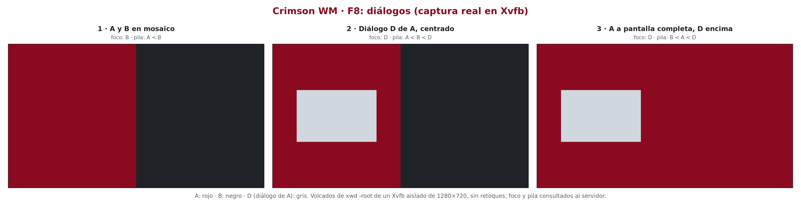
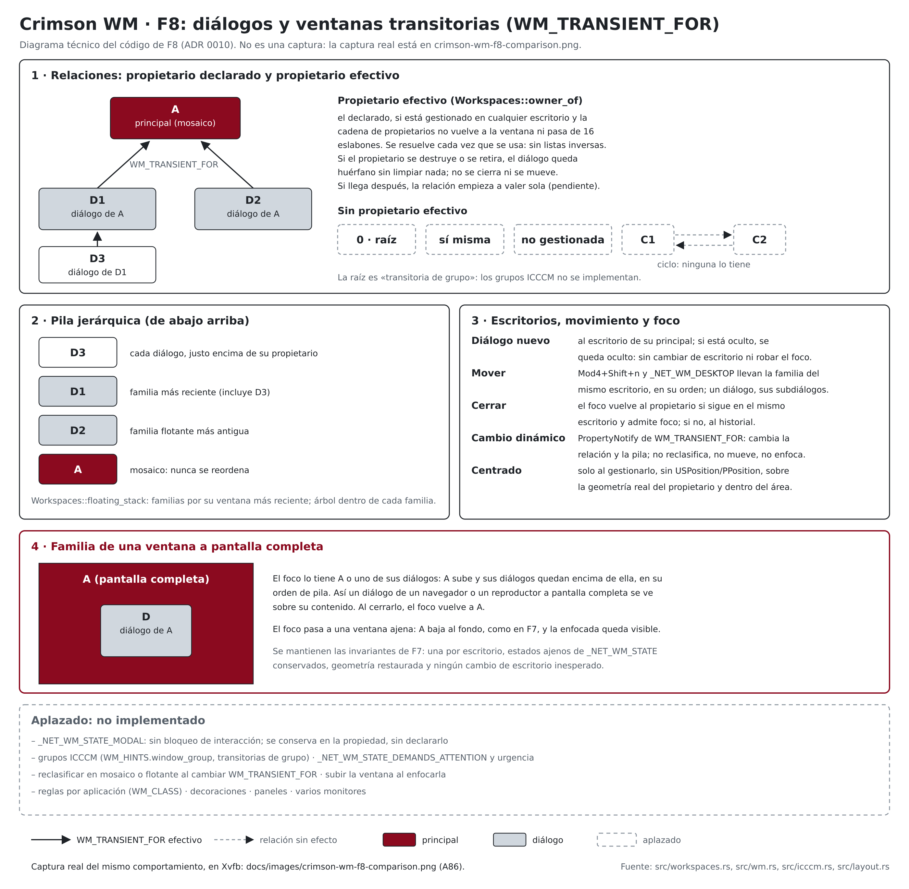

# ADR 0010: Diálogos y ventanas transitorias (F8)

- **Estado:** aceptado. Implementado el 2026-10-14 (F8-B). Las 120 pruebas
  unitarias pasaron, y las de aceptación A76–A86 pasaron en Xvfb; A87 quedó
  parcial por el mismo motivo que A9 (ver «Resultados de las pruebas de
  aceptación de F8»).
- **Fecha:** 2026-10-14
- **Corrección F8-B.1 (2026-10-14):** las comprobaciones de residuos de
  Xvfb de todos los arneses atribuyen cada recurso a su dueño, y un Xvfb de
  otro programa ya no las hace fallar (ver «Aislamiento de las
  comprobaciones de residuos (F8-B.1)»). El código de Crimson no cambia.
- **Corrección F8-B.2 (2026-10-14):** siete esperas de los arneses de F4,
  F6, F7 y F8 evaluaban su condición una sola vez; ahora la vuelven a
  evaluar en cada intento (ver «Esperas que no se volvían a evaluar
  (F8-B.2)»).
- **Actualización F9 (2026-10-14):** el centrado se decide con
  `Class::centers`: diálogos, utilidades, barras de herramientas y
  transitorias sin tipo. Los menús, tooltips y demás emergentes gestionadas
  conservan su posición aunque sean transitorias. Una ventana fija nunca es
  propietaria efectiva: un diálogo de un `DOCK` no se centra ni cambia de
  escritorio (ADR 0011).
- **Actualización F10 (2026-10-14):** el centrado limita el diálogo al área
  de trabajo, no a la pantalla, así que no nace debajo de un panel que
  reserva espacio (ADR 0012).
- **Actualización F11 (2026-10-14):** `place_with_owner` se apoya en
  `place_on`, que también usan las reglas de escritorio. Un diálogo con
  propietario efectivo sigue siempre en el escritorio de su principal: el
  escritorio de una regla se ignora y se registra (ADR 0013).

*Captura auténtica (A86): volcados de `xwd -root` de un Xvfb aislado de
1280 × 720 con Crimson WM en marcha y tres ventanas de `test-client` de
color liso. La composición solo añade rótulos, márgenes y bordes; cada
panel es idéntico píxel a píxel a su captura. Los rótulos de foco y pila
salen del servidor en el momento de cada captura.*

*Diagrama técnico elaborado a partir del código de F8; no es una captura.
Fuente editable: `docs/images/crimson-wm-f8-dialogs.svg`.*

## Contexto

Hasta F7, `WM_TRANSIENT_FOR` (ICCCM §4.1.2.6) solo decidía si una ventana
era flotante: su valor no se leía. Eso causaba los problemas anotados en
los ADR 0007 y 0008:
- un diálogo de una ventana de otro escritorio aparecía en el activo;
- al mover una ventana, sus diálogos se quedaban atrás;
- un diálogo podía quedar debajo de otra flotante, o detrás de su principal
  a pantalla completa;
- al cerrarlo, el foco iba a la ventana más reciente del historial, no
  necesariamente a la que lo abrió;
- aparecía donde lo pedía el cliente, normalmente en (0, 0).

F8 interpreta la relación sin convertirla en una segunda estructura que
mantener sincronizada, y sin depender de que los clientes la declaren bien:
el valor lo controla el cliente y puede ser 0, la raíz, la propia ventana,
una ventana no gestionada, una que aún no existe o un ciclo.

## Decisión

### Propietario declarado y propietario efectivo

- **Declarado** (`Client.transient_for: Option<Window>`): el valor de
  `WM_TRANSIENT_FOR`, interpretado por `icccm::TransientFor::parse` y
  guardado solo si es otra ventana (`TransientFor::Window`). Es un dato del
  cliente, no una referencia: no hay listas inversas ni punteros que
  limpiar.
- **Efectivo** (`Workspaces::owner_of`): el declarado, solo si
  1. está gestionado, en cualquier escritorio;
  2. la cadena de propietarios declarados que empieza en él no vuelve a la
     ventana;
  3. y no tiene más de `MAX_CHAIN` = 16 eslabones.

  Se resuelve cada vez que se usa. Una ventana de un ciclo no tiene
  propietario efectivo; una que apunta a un ciclo sin formar parte de él,
  sí.
- **Sin propietario:** 0, la raíz («transitoria de grupo»; los grupos de
  `WM_HINTS.window_group` no se implementan), la propia ventana, una
  ventana no gestionada o un ciclo. La ventana se trata como cualquier otra
  flotante. El WM registra el motivo:
  - «valor 0, la raíz o la propia ventana»;
  - «propietario pendiente o no gestionado»;
  - «ciclo o cadena de más de 16 propietarios».
- **Propietario pendiente:** si el diálogo se mapea antes que su
  principal, la relación empieza a valer sola cuando la principal se
  gestiona; no hay que volver a leer nada (A82).
- **Clasificación sin cambios:** la presencia de la propiedad, con
  cualquier valor y tipo, sigue haciendo flotante a una ventana sin tipo
  reconocido (ADR 0004). Una ventana `NORMAL` con `WM_TRANSIENT_FOR` sigue
  en mosaico, pero su relación cuenta para el escritorio, la pila y el
  foco.
- **Dependientes** (`Workspaces::dependents`): diálogos, sus diálogos,
  etc., en todos los escritorios y en orden de gestión, resueltos con el
  propietario efectivo.

### Módulos

| Módulo | Cambio |
|---|---|
| `src/icccm.rs` | `TransientFor` (`None`, `Root`, `Itself`, `Window`) con `parse` y `owner`; `WM_NORMAL_HINTS_LEN` y `explicit_position` (`USPosition` o `PPosition`) |
| `src/layout.rs` | `center`: posición centrada sobre un rectángulo y acotada al área, en `i32` y sin desbordamientos |
| `src/clients.rs` | `Class.transient_for`, `Client.transient_for` y `WindowInfo.owner`; `classify` pasa el propietario declarado |
| `src/workspaces.rs` | `MAX_CHAIN`, `owner_of`, `dependents`, `focus_return`, `floating_stack` y `move_family`; `move_focused` devuelve la familia movida; las invariantes comprueban que la relación efectiva no tiene ciclos |
| `src/wm.rs` | `log_relation`, `place_with_owner`, `center_on_owner` y `on_transient_for`; `forget` devuelve el foco al propietario; `move_to` y `move_window` mueven la familia; `restack_fullscreen` cuenta la familia; `arrange` sube las flotantes con `floating_stack` y se llama siempre antes de mapear |
| `examples/test-client.rs` | `--transient-for VENTANA\|root\|self`, `--position-hint us\|p`, `--background RRGGBB` y `--map-delay MS`; imprime «creada 0x…» antes de esperar |
| `src/main.rs`, `ewmh.rs`, `keys.rs` | Sin cambios: no hay atajos ni átomos nuevos |

### Pila jerárquica

`arrange` sube las flotantes del escritorio activo en el orden de
`floating_stack`:
- **Familias:** una flotante sin propietario efectivo entre las flotantes
  del escritorio, con sus dependientes flotantes. Un diálogo de una ventana
  en mosaico encabeza su propia familia.
- **Dentro de cada familia,** orden de árbol: cada diálogo queda justo
  encima de su propietario, y sus subdiálogos, encima de él.
- **Entre familias,** según su miembro más reciente: arriba la familia
  que tiene la ventana gestionada más tarde. Un diálogo nuevo sube así con
  toda su familia y queda visible (A77: pila «A D2 D1 D3», con D3 diálogo
  de D1).
- **El mosaico nunca se reordena:** las flotantes siempre están encima. Un
  diálogo de una ventana en mosaico queda encima de todo el mosaico.
- `_NET_CLIENT_LIST_STACKING` se publica tras cada cambio, como en F6, y
  coincide con `QueryTree` (A81).

### Escritorios y movimiento

- **Diálogo nuevo** (`place_with_owner`): va al escritorio de su
  propietario efectivo. Si ese escritorio está oculto, el diálogo se
  gestiona allí oculto: no se mapea, recibe `WM_STATE` Iconic y
  `_NET_WM_DESKTOP`, y pasa a ser el más reciente de su historial. El
  escritorio activo y el foco no cambian (A78). Al mostrar ese escritorio,
  el diálogo aparece encima de su principal y con el foco.
- **Mover** (`Mod4+Shift+n` o `_NET_WM_DESKTOP`): la ventana se lleva sus
  dependientes transitivos **de su mismo escritorio**, en su orden
  (`move_family`). Mover un diálogo se lleva sus subdiálogos, no a su
  principal (A79). Un dependiente que ya estaba en otro escritorio no se
  mueve.
- **Pantalla completa:** cada miembro conserva su estado al moverse; si el
  destino ya tenía una ventana a pantalla completa, la última gana (ADR
  0009).

### Foco

- **Al abrirse,** un diálogo que admite foco lo recibe, como en F3. Si
  queda oculto, no.
- **Al cerrarse un diálogo enfocado** (`focus_return`): el foco vuelve a
  su propietario efectivo si sigue en el mismo escritorio y admite foco;
  si no, al historial, como en F5. El propietario se resuelve antes de
  olvidar el diálogo.
  - En un escritorio oculto, el propietario pasa a ser el primero de ese
    historial, y recibe el foco al mostrarlo.
  - Ejemplo (A84): con el historial «D, B, A», D cambia su propietario de
    B a A; al cerrarlo, el foco va a A, no a B.
- **Sin principal** (destruida o retirada): el diálogo sigue gestionado,
  visible y donde estaba; no se cierra ni se mueve (A80). Al cerrarlo, el
  foco sigue el historial.

### Centrado

`center_on_owner`, solo al gestionar un diálogo flotante:
- **Se centra** sobre la geometría real del propietario (`GetGeometry`),
  contando el borde, y dentro del área (`layout::center`). Si es mayor que
  el área, queda en su esquina superior izquierda.
- **No se centra:**
  - sin propietario efectivo, también si está pendiente (A82);
  - si `WM_NORMAL_HINTS` pide una posición (`USPosition` o `PPosition`), que
    se respeta (A85);
  - si alguna de las dos ventanas ya no existe.
- **Después,** las peticiones `ConfigureRequest` se atienden como en
  cualquier flotante, y el WM no vuelve a centrar al reorganizar (A85).
- **Adopción:** las ventanas adoptadas al arrancar no se centran; ya
  tenían una posición.

### Familia a pantalla completa

`restack_fullscreen` (ADR 0009) cuenta la familia:
- **El foco lo tiene la ventana o un dependiente suyo del mismo
  escritorio:** sube, y sus dependientes quedan encima de ella en su orden
  de pila. Así un diálogo de un navegador o un reproductor a pantalla
  completa se ve (A83 y A86).
- **El foco pasa a una ventana ajena:** baja al fondo, como en F7.
- Se mantienen las invariantes de F7: una por escritorio, estados ajenos
  de `_NET_WM_STATE` conservados y geometría restaurada.

### Cambios dinámicos (`PropertyNotify`)

`on_transient_for` vuelve a leer y validar `WM_TRANSIENT_FOR` de una
ventana gestionada y actualiza su propietario declarado:
- **No** reclasifica (mosaico o flotante), no mueve de escritorio y no
  cambia el foco; solo recoloca la pila (A84).
- Un cambio sin efecto no hace nada.
- Un ciclo creado así se detecta: ninguna de las dos ventanas tiene
  propietario efectivo, se registra y el WM sigue en marcha (A81).
- El WM nunca escribe esta propiedad, así que no hay bucles.

### Carreras X11

- **Diálogo antes que su principal:** propietario pendiente; la relación
  se resuelve al gestionarse la principal (A82). No se centra.
- **Principal destruida entre el `MapRequest` y el centrado:**
  `GetGeometry` falla y el diálogo no se centra. Su `DestroyNotify` la
  olvida, y `owner_of` deja de verla sin limpiar nada.
- **Diálogo destruido mientras se gestiona:** igual que cualquier ventana
  (ADR 0004 y 0008): los errores se registran y su `DestroyNotify` lo
  olvida.
- **Cambio de `WM_TRANSIENT_FOR` justo al cerrar:** si la ventana ya no
  está gestionada, el `PropertyNotify` se ignora.
- **Relación que cambia entre dos usos:** como se resuelve cada vez, nunca
  hay un estado intermedio incoherente.

## Verificación

### Pruebas unitarias (120 en total, 9 más que en F7)

- **U19** (`icccm`, 2):
  - `WM_TRANSIENT_FOR`: ausente, 0, raíz, propia ventana y otra ventana
    (con valores sobrantes); `owner` solo para `Window`;
  - `WM_NORMAL_HINTS`: ausente, sin bandera, `USPosition`, `PPosition`,
    solo tamaños y combinaciones.
- **U20** (`layout`, 2; `workspaces`, 5):
  - centrado sobre la maestra y sobre la pila, con borde; dentro del área,
    mayor que el área y con valores extremos sin desbordamientos;
  - propietario efectivo: declarado, no gestionado y en otro escritorio;
  - ciclos de dos y tres, ventana que apunta a un ciclo, y cadenas de 16 y
    17 eslabones;
  - dependientes transitivos y retorno del foco (mismo escritorio, otro
    escritorio y propietario que no admite foco);
  - pila jerárquica con varias familias y subdiálogos;
  - mover una familia: solo los dependientes del mismo escritorio, en su
    orden, y mover un diálogo sin su principal.

  Las 5 000 operaciones pseudoaleatorias asignan ahora propietarios
  declarados arbitrarios, que pueden formar ciclos. Las invariantes
  comprueban que la relación efectiva no tiene ciclos y que solo apunta a
  ventanas gestionadas distintas de la propia.

No se hicieron pruebas de mutación: no hay ninguna herramienta instalada
para ello.

### Pruebas de aceptación (`tests/acceptance/f8/`)

Mismo aislamiento que en F4–F7. Solo `xev`, `xlogo` y `test-client`; nunca
aplicaciones reales.

| Id | Comprobación |
|---|---|
| A76 | Diálogo de A, flotante y registrado como tal; recibe el foco, queda encima de A y centrado sobre ella (170, 260); al cerrarlo, el foco vuelve a A aunque B es más reciente en el historial |
| A77 | Dos diálogos de A y un subdiálogo de D1: pila «A D2 D1 D3»; al cerrar D3 el foco va a D1, y al cerrar D1, a A |
| A78 | Diálogo de A (escritorio 2) abierto desde el 1: queda oculto en el 2 (`_NET_WM_DESKTOP` 1), sin cambiar el escritorio ni el foco; al mostrar el 2, aparece encima de A, centrado y enfocado |
| A79 | `Mod4+Shift+3` sobre A lleva A, D y E (diálogo de D) al 3; `Mod4+Shift+4` sobre D lleva D y E, no A; `_NET_WM_DESKTOP` sobre A, sin dependientes en su escritorio, solo la mueve a ella |
| A80 | Principal destruida (`kill`) o retirada (`windowunmap`): el diálogo sigue gestionado y visible; al cerrarlo, el foco sigue el historial |
| A81 | Raíz, propia ventana e identificador ajeno: sin propietario, con su motivo en el registro; ciclo C1 → C2 → C1 creado con `xprop`: detectado y el WM sigue en marcha; `_NET_CLIENT_LIST_STACKING` coincide con `QueryTree` |
| A82 | Diálogo mapeado 3 s antes que su principal: «propietario pendiente»; al llegar la principal, queda encima de ella y sin centrar |
| A83 | Diálogo de una ventana a pantalla completa: enfocado, encima de ella y centrado; la principal conserva el área y FULLSCREEN; al cerrarlo, el foco vuelve a ella; con una ventana ajena enfocada, baja al fondo |
| A84 | `WM_TRANSIENT_FOR` cambiado con `xprop`: D pasa de B a A sin reclasificar, mover ni cambiar el foco, y al cerrarlo el foco va a A; un cambio hacia una ventana de otro escritorio no mueve el diálogo; apuntarse a sí misma la deja sin propietario |
| A85 | Centrado sin pistas; `USPosition` y `PPosition` respetadas; diálogo de 1000 × 700 acotado al área; tras moverlo, una reorganización no lo vuelve a centrar |
| A86 | Captura real (abajo) |
| A87 | Como A9: sin pánicos ni residuos, sin programas falsos en marcha ni aplicaciones nuevas, y bspwm y sxhkd con el mismo PID |

### Cambios en los arneses anteriores

F8 no añade atajos ni átomos, así que las listas esperadas de F5–F7 no
cambian. En F8-B.1 cambian dos archivos compartidos por todas las fases,
`tests/acceptance/f1/lib.sh` y `tests/acceptance/f1/xvfb-env.sh`, para
atribuir los residuos de Xvfb (sección siguiente). Los identificadores de
las comprobaciones no cambian.

## Resultados de las pruebas de aceptación de F8

Ejecutadas el 2026-10-14 con `tests/acceptance/f8/run.sh` sobre el binario
de depuración, con las mismas herramientas que en F7.

**F8: 106 comprobaciones OK, 0 FALLA y 1 OMITIDA** (`A87-xprop-:0`), con
código de salida 0 y todos los `xvfb-run` con 0. Durante el desarrollo solo
hubo fallos del arnés, ya corregidos:
- A84 se reordenó (el diálogo empieza siendo de B y pasa a A) para
  distinguir la vuelta al propietario de la vuelta al historial;
- faltaba la función `focus_on`;
- la evidencia de A86 se partía en varias líneas;
- se añadió la leyenda de colores al pie de A86.

Regresiones, sobre el mismo binario:
- **F1:** 46 OK y 1 OMITIDA. Como siempre, el `xvfb-run` de A8 termina con
  1 (ADR 0003).
- **F2:** en la batería completa, 4 FALLA en `A21-sin-residuos-*`;
  repetida, 47 OK, 0 FALLA y 1 OMITIDA.
- **F3:** 61 OK y 1 OMITIDA.
- **F4:** 79 OK y 1 OMITIDA.
- **F5:** 142 OK y 1 OMITIDA.
- **F6:** 118 OK, 4 FALLA en `A64-sin-residuos-*` y 1 OMITIDA, en la
  batería y al repetirla. **Todas las comprobaciones funcionales pasaron.**
- **F7:** 123 OK y 1 OMITIDA.

Los fallos de F2 y F6 se diagnosticaron y corrigieron en F8-B.1 (sección
siguiente).

### Aislamiento de las comprobaciones de residuos (F8-B.1)

**Causa exacta.** `snapshot` y `session_checks`
(`tests/acceptance/f1/lib.sh`, compartidas por F1–F8) hacían una
instantánea **global** antes y después de la batería:
- `pgrep -x Xvfb`: todos los Xvfb del sistema;
- `find /tmp -name '.X*-lock'`: todos los locks;
- `find /tmp/.X11-unix`: todos los sockets;
- `find $TMPDIR -name 'xvfb-run.*'`: todos los directorios temporales de
  `xvfb-run`.

Cualquier elemento de la segunda instantánea que no estuviera en la primera
contaba como residuo, sin mirar de quién era. Un banco de pruebas de otro
proyecto del usuario (`labtrace-spike-s1-egui`, ejecutado con `xvfb-run
-a`) arranca y detiene Xvfb en ciclos. Cuando uno de ellos arrancaba
durante la batería y seguía vivo al final, sus cuatro recursos (en F6, el
Xvfb de la pantalla `:100`, `/tmp/.X100-lock`, `/tmp/.X11-unix/X100` y su
`/tmp/xvfb-run.*`) aparecían como «nuevos», y fallaban las cuatro
comprobaciones `*-sin-residuos-*`. Por eso F2 falló una vez y pasó al
repetirla, y F6 falló las dos veces. El problema afectaba por igual a
F1–F8, porque todas usan las mismas funciones.

Ningún recurso era de Crimson: ningún caso registró esos PID, la línea de
órdenes del proceso es la del banco de pruebas ajeno y todos los
`xvfb-run` del arnés terminaron con el código esperado. Esos procesos no se
tocaron.

**Corrección** (solo en los dos archivos compartidos del arnés):
- **Anotación de los recursos propios** (`xvfb-env.sh`): al empezar cada
  caso, antes de las guardas, se anotan en `$OUT/xvfb-propios.tsv` el caso,
  el PID de su `xvfb-run`, el del Xvfb hijo de ese `xvfb-run`, el `DISPLAY`
  y la cookie (dentro del directorio temporal de `xvfb-run`). Solo se lee
  `/proc`; no se conecta nada.
- **Residuos propios** (`own_left`), comprobados todos, sean nuevos o no,
  y siempre FALLA:
  - un Xvfb propio vivo: el mismo PID **y** su cookie en `-auth`, para no
    confundirlo con un proceso que reutilice el PID;
  - el lock de un display propio que contenga el PID de un Xvfb propio;
  - el socket de un display propio, salvo que su lock lo tenga ya un
    servidor ajeno (que reutilizó el display después);
  - el directorio temporal de un `xvfb-run` propio.

  `xvfb-run` envía la señal a su Xvfb sin esperar a que termine, así que se
  dan hasta 5 s para que desaparezcan; un residuo real persiste.
- **Recursos nuevos ajenos:** los que aparecen entre las instantáneas y no
  son de ningún Xvfb propio. Se registran en la evidencia, con su PID o su
  display, y no hacen fallar la prueba.
- **Fail-closed:** solo se aceptan recursos ajenos si la lista está
  completa, es decir, si hay una anotación válida por cada `xvfb-run` que
  lanzó el arnés. Si falta alguna, cualquier recurso nuevo cuenta como «sin
  atribuir» y la comprobación falla. Así un Xvfb propio no anotado nunca
  pasa por ajeno.
- **Sin cambios:** las instantáneas, los identificadores, las guardas de
  `xvfb-env.sh`, el resto de comprobaciones de sesión y las de cada caso.

**Validación con Xvfb reales** (arnés sintético fuera del repositorio, que
carga los mismos `lib.sh` y `xvfb-env.sh`):

| Escenario | Resultado |
|---|---|
| Caso limpio y un Xvfb «ajeno» (no anotado) que arranca durante la ejecución | 4 OK; el ajeno, su lock, su socket y su directorio, atribuidos como ajenos |
| Fuga real: el caso mata con SIGKILL su propio `xvfb-run`, que no limpia | 4 FALLA: el Xvfb propio vivo, su lock, su socket y su directorio temporal |
| Como el primero, pero con la anotación propia borrada | 4 FALLA: todos los recursos nuevos, «sin atribuir» |

En el primer escenario, el Xvfb propio seguía vivo en la segunda
instantánea (`xvfb-run` no espera) y desapareció dentro del margen de 5 s.
Tras cada escenario se limpiaron solo los recursos lanzados por el propio
arnés sintético. En la primera ejecución, el `kill` sobre el `xvfb-run`
«ajeno» simulado lo terminó sin su limpieza, y dejó dos Xvfb huérfanos
lanzados por esa validación. Se identificaron por su línea de órdenes, se
terminaron y se borraron sus directorios. Después, el arnés sintético
termina el `sleep` de ese `xvfb-run`, que hace su propia limpieza.

**F6 con un Xvfb ajeno presente** (`tests/acceptance/f6/run.sh`, con un
`xvfb-run` ajeno simulado que arranca a mitad de la batería y sigue vivo en
la instantánea final, además del banco de pruebas externo):
**122 OK, 0 FALLA y 1 OMITIDA**, código 0. La evidencia registra
«11 Xvfb propios anotados de 11 xvfb-run», el Xvfb ajeno `:99`, su lock, su
socket y su directorio como ajenos, y ningún residuo propio.

**Demás baterías tras F8-B.1** (mismo binario de F8; cambiaron archivos
compartidos, así que se repitieron todas):

| Fase | Resultado | Xvfb propios anotados |
|---|---|---|
| F1 | 46 OK, 0 FALLA, 1 OMITIDA (el `xvfb-run` de A8 termina con 1, como siempre) | 12 de 12 |
| F2 | 47 OK, 0 FALLA, 1 OMITIDA | 11 de 11 |
| F3 | 61 OK, 0 FALLA, 1 OMITIDA | 10 de 10 |
| F4 | 79 OK, 0 FALLA, 1 OMITIDA (en la segunda ejecución; ver abajo) | 7 de 7 |
| F5 | 142 OK, 0 FALLA, 1 OMITIDA | 11 de 11 |
| F6 | 122 OK, 0 FALLA, 1 OMITIDA (con un Xvfb ajeno presente) | 11 de 11 |
| F7 | 123 OK, 0 FALLA, 1 OMITIDA | 11 de 11 |
| F8 | 106 OK, 0 FALLA, 1 OMITIDA | 11 de 11 |

La única OMITIDA de cada fase es la consulta deliberadamente omitida de
`:0`. En todas, las cuatro comprobaciones de residuos dieron «ninguno
propio».

**Fallo intermitente ajeno a F8-B.1 (F4, A38).** La primera ejecución de F4
dio 78 OK y 1 FALLA en `A38-pasado-el-intervalo` (esperado 2, obtenido 2).
La causa es un error latente del arnés de F4: en
`wait_for test "$(count kitty)" = 2`, la sustitución se evalúa una sola vez,
antes de llamar a `wait_for`, que repite durante 5 s una comparación con un
valor fijo. El segundo lanzamiento se registró unos milisegundos después de
esa lectura (las marcas de tiempo de los registros del programa falso lo
muestran), así que la espera no podía cumplirse; al registrar el resultado,
la cuenta ya era 2. La segunda ejecución pasó. El mismo patrón aparece en
otros seis puntos de los arneses (F6: 3; F7: 2; F8: 1, en A79), donde hasta
ahora la condición ya se cumplía al evaluarla. No se corrigió en F8-B.1,
que se limita al aislamiento de los residuos; se corrige en F8-B.2.

### Esperas que no se volvían a evaluar (F8-B.2)

**Causa.** `wait_for orden...` (`tests/acceptance/f1/lib.sh`) repite la
orden cada 0,1 s durante 5 s. En la forma
`wait_for test "$(función)" = valor`, Bash expande la sustitución **una
sola vez**, al construir los argumentos y antes de llamar a `wait_for`.
Por eso `wait_for` repetía `test 1 = 2` con un valor fijo: si el estado
real todavía no había cambiado en ese instante, la espera se agotaba
aunque cambiara después. Solo funcionaba cuando la condición ya se cumplía
en la primera lectura, de modo que la espera no servía de nada.

**Las siete apariciones** (todas las de la forma
`wait_for test "$(…)" = valor`):

| Arnés | Caso | Antes | Después |
|---|---|---|---|
| `f4/xvfb-case.sh:313` | A38 | `wait_for test "$(count kitty)" = 2` | `wait_for output_is 2 count kitty` |
| `f6/xvfb-case.sh:324` | A54 (precondición) | `wait_for test "$(owner)" = ninguno` | `wait_for output_is ninguno owner` |
| `f6/xvfb-case.sh:474` | A58 (precondición) | `wait_for test "$(net_desk A)" = 4` | `wait_for output_is 4 net_desk A` |
| `f6/xvfb-case.sh:543` | A61 | `wait_for test "$(net_desk A)" = 5` | `wait_for output_is 5 net_desk A` |
| `f7/xvfb-case.sh:456` | A69 | `wait_for test "$(net_desk B)" = 1` | `wait_for output_is 1 net_desk B` |
| `f7/xvfb-case.sh:599` | A73 (precondición) | `wait_for test "$(net_desk C)" = 2` | `wait_for output_is 2 net_desk C` |
| `f8/xvfb-case.sh:411` | A79 | `wait_for test "$(net_desk A)" = 1` | `wait_for output_is 1 net_desk A` |

Las demás líneas con `$(…)` junto a `wait_for` usan la sustitución en un
término `&&` posterior, que se evalúa al terminar la espera; son correctas
y no cambian. `f7/xvfb-case.sh:601` usa `wait_for eval '…'`, que sí se
vuelve a evaluar; tampoco cambia.

**Solución.** Una función auxiliar en `lib.sh`,
`output_is valor orden...`, ejecuta la orden y compara su salida, sin los
saltos de línea finales, con el valor (`[[ $("$@") == "$valor" ]]`). Como
`wait_for` la llama en cada intento, la orden se vuelve a ejecutar cada
vez:
- es la misma igualdad literal que `test`, sin patrones ni comparación
  numérica;
- no usa `eval` ni ejecuta texto como código: la orden y sus argumentos
  llegan como palabras separadas;
- se mantienen el plazo de 5 s, las aserciones y los registros.

**Prueba controlada** (script fuera del repositorio que carga el mismo
`lib.sh`, sin X ni aplicaciones): un contador en un archivo vale 1 y un
proceso lo cambia a 2 al cabo de 1 s.

| Espera | Resultado |
|---|---|
| Valor inicial | 1: no cumple «= 2» |
| `wait_for test "$(count_file)" = 2` (forma antigua) | agotada tras 5,12 s, aunque el valor real ya era 2 |
| `wait_for output_is 2 count_file` | cumplida tras 1,05 s |
| `wait_for output_is 3 count_file` (nunca se cumple) | agotada tras 5,25 s, en el límite de 50 × 0,1 s |

Además, `output_is` no acepta `[0-9]` como patrón, distingue «02» de «2»,
como `test`, y no se cumple con una orden sin salida.

**Regresiones tras F8-B.2** (mismo binario; solo cambian los arneses de F4,
F6, F7 y F8 y la función nueva de `lib.sh`, que no usan F1–F3 ni F5):

| Fase | Resultado |
|---|---|
| F4 | 79 OK, 0 FALLA, 1 OMITIDA; `A38-pasado-el-intervalo` OK |
| F6 | 122 OK, 0 FALLA, 1 OMITIDA; precondiciones de A54 y A58 cumplidas, `A61-oculta-a-oculto` OK |
| F7 | 123 OK, 0 FALLA, 1 OMITIDA; `A69-net-wm-desktop` OK, precondición de A73 cumplida |
| F8 | 106 OK, 0 FALLA, 1 OMITIDA; `A79-net-wm-desktop` OK |

Todas terminaron con código 0 y con todos los `xvfb-run` en 0. Las
comprobaciones de residuos de F8-B.1 siguieron activas: todos los Xvfb
propios quedaron anotados (7 de 7 en F4 y 11 de 11 en las demás), sin
ningún residuo propio ni recursos ajenos nuevos.

**Toolchain:** fmt y clippy se ejecutaron con los binarios de Debian
(`/usr/bin/cargo-fmt` y `/usr/bin/cargo-clippy`, 0.1.85), con `PATH`
limitado a `/usr/bin:/bin`, como se indica en ADR 0009: el rustup de
`~/.cargo/bin` (1.99) no es la toolchain del proyecto (ADR 0001).

## Documentación visual

### Captura real (A86)

La genera el propio arnés, con el aislamiento de las demás pruebas:
1. A (`#8B0A1F`, rojo) y B (`#1F2328`, negro) en master-stack, con B
   enfocada.
2. D (`#D0D7DE`, gris), diálogo de A de 400 × 260, centrado sobre A y
   enfocado.
3. `Mod4+f` sobre A: A a pantalla completa y D encima, con el foco.
4. `xwd -root` en cada momento, conversión a PNG con ImageMagick y
   composición con rótulos, márgenes, bordes y una leyenda, sin retocar el
   contenido.

Validaciones registradas en la ejecución:
- **Geometrías:** A 0 0 640 720 y B 640 0 640 720; D 120 230 400 260 con
  borde 0; pila «B A D» en la captura 3.
- **Dimensiones:** las tres capturas, de 1280 × 720.
- **Colores** en puntos conocidos de cada captura:
  `8B0A1F 1F2328 D0D7DE 8B0A1F 8B0A1F D0D7DE` (A y B; D sobre A; A a
  pantalla completa con D encima).
- **Rótulos** con el foco y la pila leídos del servidor: «foco: B · pila:
  A < B», «foco: D · pila: A < B < D» y «foco: D · pila: B < A < D».
- **Composición** (4012 × 1024): cada panel es idéntico píxel a píxel a su
  captura (0 0 0 píxeles distintos).
- **SHA-256** de `docs/images/crimson-wm-f8-comparison.png`:
  `e3989b8b475039ab8fc00ae089e4bb5ffcf42b9c1de6a689e53d93b2d7305304`, la
  misma que la de la ejecución definitiva. El archivo no contiene rutas
  locales.

Las tres capturas sin componer quedan como evidencia temporal en el
directorio de resultados; en el repositorio solo se registra la
comparación.

### Diagramas

- `docs/images/crimson-wm-f8-dialogs.svg` (fuente editable) y su PNG
  (2800 × 2740, escala 2), renderizado con `tools/render-svg.py`. Volver a
  renderizar el SVG da 0 píxeles distintos.
- `docs/images/crimson-wm-overview.svg` se actualiza a F8. Las imágenes de
  F2, F6 y F7 no cambian.

## Limitaciones conocidas

- **Sin `_NET_WM_STATE_MODAL`:** un diálogo modal no bloquea la interacción
  con su principal. El estado se conserva en la propiedad, pero no se
  declara ni se interpreta.
- **Sin grupos ICCCM** (`WM_HINTS.window_group`): una transitoria de la
  raíz no tiene propietario.
- **Sin urgencia** (`_NET_WM_STATE_DEMANDS_ATTENTION`, `UrgencyHint`): un
  diálogo que queda oculto con su principal puede pasar desapercibido hasta
  mostrar su escritorio.
- **Sin reclasificación:** un `WM_TRANSIENT_FOR` añadido o quitado después
  del mapeo cambia la relación, pero no hace flotante ni de mosaico a la
  ventana.
- **Enfocar no sube:** enfocar una flotante tapada con el teclado no la
  sube; la pila solo cambia al gestionar, reorganizar o cambiar
  la relación.
- **El mosaico nunca se reordena:** un diálogo en mosaico (tipo `NORMAL`
  con `WM_TRANSIENT_FOR`) no queda encima de su principal.
- **El centrado** solo se hace al gestionar, nunca en la adopción, y no
  tiene en cuenta paneles ni varios monitores (no hay struts ni RandR).
- **Un diálogo cuya principal está en otro escritorio** (por un cambio
  dinámico o por mover solo la principal) se queda donde está.

## Alternativas consideradas

- **Listas inversas de dependientes en cada cliente:** descartado; habría
  que mantenerlas al destruir, retirar, mover y cambiar la propiedad, y una
  referencia colgante rompería las invariantes. Resolver cada vez es O(n)
  sobre pocas ventanas.
- **Llevar el escritorio activo al del diálogo nuevo:** descartado; robaría
  el foco, como en ADR 0007.
- **Diálogo siempre encima de todo:** descartado; taparía otras familias
  más recientes.
- **Reclasificar al cambiar `WM_TRANSIENT_FOR`:** descartado; un cambio
  después del mapeo es raro y moverlo entre mosaico y flotante sería
  sorprendente.
- **Implementar MODAL y grupos ya:** aplazado; F8 se limita a la relación
  directa, que es lo que usan la mayoría de las aplicaciones.
- **Centrar en cada reorganización:** descartado; desharía los movimientos
  del usuario o del cliente.

## Consecuencias

- La relación entre ventanas existe sin estado propio: `Workspaces` la
  resuelve a partir del dato declarado de cada cliente.
- `arrange` sube las flotantes por familias y se llama siempre antes de
  mapear una ventana nueva, también las flotantes.
- Mover una ventana puede mover varias: `Workspaces::move_focused` y
  `move_family` devuelven la lista de las movidas.
- Las reglas por aplicación (`WM_CLASS`), los grupos y MODAL podrán
  apoyarse en `owner_of` y `dependents`.
