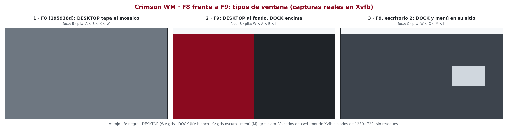
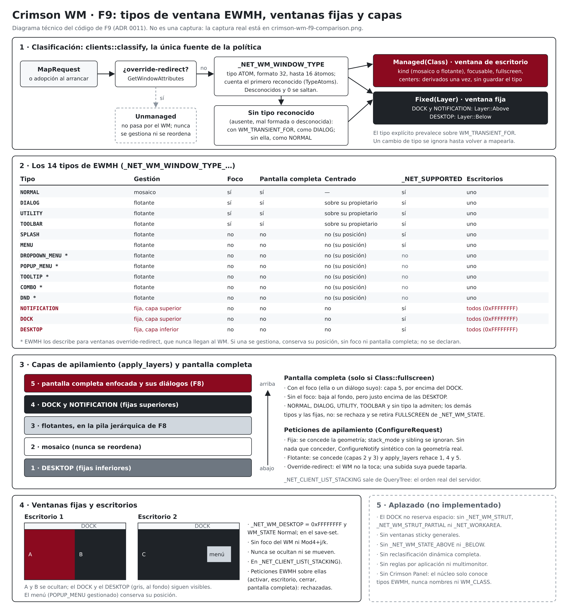

# ADR 0011: Tipos de ventana EWMH, ventanas fijas y capas de apilamiento (F9)

- **Estado:** aceptado. Implementado el 2026-10-14 (F9-B). Las 126 pruebas
  unitarias pasaron, y las de aceptación A88–A102 pasaron en Xvfb; A103
  quedó parcial por el mismo motivo que A9 (ver «Resultados de las pruebas
  de aceptación de F9»).
- **Fecha:** 2026-10-14
- **Actualización F10 (2026-10-14):** `Disposition::Fixed` lleva un
  `FixedKind` (`Dock`, `Notification` o `Desktop`) en lugar de `Layer`;
  `FixedKind::layer` mantiene las mismas capas. Solo los `Dock` reservan
  espacio con sus struts. *La limitación «el `DOCK` no reserva espacio»
  está resuelta (ADR 0012); los demás pendientes siguen igual.*
- **Actualización F11 (2026-10-14):** las reglas de ventanas no se aplican
  a las fijas (`DOCK`, `NOTIFICATION` y `DESKTOP`) ni a las
  override-redirect, y una regla no puede dar la pantalla completa a un
  tipo que no la admite (ADR 0013).

*Capturas auténticas (A101 con el binario de F8, compilado a partir del
commit 195938d, y A102 con el de F9): volcados de `xwd -root` de Xvfb
aislados de 1280 × 720 con ventanas de `test-client` de color liso. La
composición solo añade rótulos, márgenes y bordes; cada panel es idéntico
píxel a píxel a su captura. Los rótulos de foco y pila salen del servidor
en el momento de cada captura.*

*Diagrama técnico elaborado a partir del código de F9; no es una captura.
Fuente editable: `docs/images/crimson-wm-f9-window-types.svg`.*

## Contexto

Hasta F8, `_NET_WM_WINDOW_TYPE` solo decidía entre mosaico y flotante, y si
la flotante recibía el foco (ADR 0004 y 0005). El análisis de F9-A encontró
cuatro defectos de comportamiento:

- **D1, `DESKTOP`:** contaba como flotante, y `arrange` sube todas las
  flotantes. Una ventana de escritorio de pantalla entera tapaba el mosaico
  (panel 1 de la captura) y, además, se ocultaba al cambiar de escritorio.
- **D2, `DOCK` y `NOTIFICATION`:** quedaban en el escritorio donde
  aparecían y se ocultaban al cambiar de escritorio.
- **D3, menús gestionados:** `center_on_owner` se aplicaba a cualquier
  flotante con propietario. Un menú o un tooltip gestionado, con
  `WM_TRANSIENT_FOR` y sin `USPosition`/`PPosition`, se movía al centro de
  su principal.
- **D4, pantalla completa:** se aceptaba en cualquier ventana gestionada,
  también en tipos sin foco, que nunca subían.

## Decisión

### Modelo

- **`ewmh::WindowType`:** los 14 tipos de EWMH. `WindowType::NAMES` da sus
  átomos, en el mismo orden.
- **`ewmh::TypeAtoms`:** los átomos de los 14 tipos en el servidor. Es la
  única tabla que traduce átomos a tipos; `wm.rs` los registra a partir de
  `WindowType::NAMES`, así que nombre, átomo y tipo no pueden
  desalinearse. `window_type` devuelve el **primer tipo reconocido** de la
  lista, que está en orden de preferencia (EWMH). Los desconocidos y el 0
  se saltan.
- **Lectura acotada:** `_NET_WM_WINDOW_TYPE` se lee con tipo `ATOM`,
  formato 32 y como mucho 16 valores, como desde F2. Un tipo o formato
  distinto llega vacío y cuenta como ausente; de una lista más larga solo
  se miran los 16 primeros.
- **`clients::Disposition`:** `Unmanaged` (override-redirect), `Managed(Class)`
  (ventana de escritorio) o `Fixed(Layer)` (ventana fija).
- **`clients::Layer`:** `Below` (`DESKTOP`) o `Above` (`DOCK` y
  `NOTIFICATION`).
- **`clients::classify`** es la única fuente de la clasificación y de las
  políticas derivadas. `Class` gana dos campos: `fullscreen` (admite la
  pantalla completa) y `centers` (se centra sobre su propietario al
  gestionarse). Hoy `fullscreen` coincide con `focusable` y `centers` con
  «flotante con foco», pero son capacidades distintas y se mantienen
  separadas.
- **Sin estado redundante:** el tipo no se guarda. `Client` conserva
  `kind`, `focusable` y, desde F9, `fullscreen_allowed`, que se fijan al
  gestionarla y no cambian mientras siga gestionada; `centers` solo se usa
  en ese momento.

### Tratamiento de cada tipo

| Tipo | Gestión | Foco | Pantalla completa | Centrado | `_NET_SUPPORTED` |
|---|---|---|---|---|---|
| `NORMAL` | mosaico | sí | sí | no | sí |
| `DIALOG`, `UTILITY`, `TOOLBAR` | flotante | sí | sí | sobre su propietario | sí |
| `SPLASH`, `MENU` | flotante | no | no | no | sí |
| `DROPDOWN_MENU`, `POPUP_MENU`, `TOOLTIP`, `COMBO`, `DND` | flotante | no | no | no | no |
| `NOTIFICATION`, `DOCK` | fija, capa superior | no | no | no | sí |
| `DESKTOP` | fija, capa inferior | no | no | no | sí |
| Sin tipo reconocido, con `WM_TRANSIENT_FOR` | flotante | sí | sí | sobre su propietario | — |
| Sin tipo reconocido | mosaico | sí | sí | no | — |
| Override-redirect (cualquier tipo) | no se gestiona | — | — | — | — |

- El tipo explícito prevalece sobre `WM_TRANSIENT_FOR`, como desde F2: un
  `NORMAL` transitorio va al mosaico y un `DOCK` transitorio es fijo.
- `SPLASH` sigue flotante y sin foco, sin centrado automático (decisión 8
  de F9-A).
- `UTILITY` y `TOOLBAR` no cambian: reciben el foco y se centran, como
  cualquier flotante con foco desde F8.

### Lista definitiva de `_NET_SUPPORTED`

Solo se declaran capacidades implementadas y probadas. Respecto a F8 se
añaden cinco tipos:

- **`SPLASH` y `MENU`:** EWMH los describe para ventanas gestionadas
  (pantalla de presentación y menú desprendido). El WM les aplica un
  tratamiento definido y probado (A90, A95): flotantes, sin foco, en su
  posición y sin pantalla completa.
- **`DOCK`, `DESKTOP` y `NOTIFICATION`:** tienen el tratamiento propio de
  las ventanas fijas (A92–A94, A98, A99).

No se declaran `DROPDOWN_MENU`, `POPUP_MENU`, `TOOLTIP`, `COMBO` ni `DND`.
Según el texto de EWMH 1.5 (citado de memoria; no se ha podido consultar
sin red), se usan normalmente en ventanas override-redirect, que nunca
llegan al WM. El WM los reconoce para que, si alguno llega a gestionarse,
no se centre, no reciba el foco ni se ponga a pantalla completa, pero no
tiene un tratamiento propio que anunciar. Tampoco se declaran los struts,
`_NET_WORKAREA`, `_NET_WM_STATE_ABOVE`/`BELOW` ni `_NET_WM_STATE_STICKY`:
declarar `DOCK` no promete reservar espacio.

La lista exacta, de 21 átomos, está en `ewmh::SUPPORTED` y la comprueban
la prueba unitaria U16/U21 y las de aceptación A53 (F6) y A100.

### Ventanas fijas

- **Colección propia** (`Workspaces::fixed`), separada de los ocho
  escritorios, con `{ window, layer, order }`. `order` comparte el contador
  de `Client::order`, así que `_NET_CLIENT_LIST` las intercala en orden de
  gestión.
- **Invariantes** (`Workspaces::assert_consistent`, prueba pseudoaleatoria
  ampliada): una ventana nunca está a la vez en un escritorio y en la
  colección fija, ni dos veces en ella; una fija nunca es propietaria
  efectiva (`owner_of` solo ve ventanas de escritorio).
- **Al gestionarla** (`Wm::manage_fixed`): save-set, como todas las
  gestionadas; `WM_STATE` Normal; `_NET_WM_DESKTOP` = `0xFFFFFFFF`;
  `PropertyChange` (solo para registrar cambios de tipo) y nunca
  `FocusChange`. Se coloca en su capa **antes** de mapearla, así que una
  `DESKTOP` nunca aparece un instante por encima de las demás.
- **`0xFFFFFFFF` no es «sticky»:** el WM lo publica en las fijas porque
  están en todos los escritorios, pero una petición `_NET_WM_DESKTOP` =
  `0xFFFFFFFF` de un cliente se sigue rechazando (ADR 0008).
- **Fuera de los escritorios:** `locate` y `get` no las ven, así que nada
  de lo que actúa sobre los escritorios las toca: no entran en el mosaico,
  ni en el historial de foco, ni en `Mod4+j`/`Mod4+k`; `show` no las oculta;
  `Mod4+Shift+n` y `_NET_WM_DESKTOP` no las mueven.
- **Peticiones EWMH rechazadas:** `_NET_ACTIVE_WINDOW`, `_NET_WM_DESKTOP`,
  `_NET_CLOSE_WINDOW` y `_NET_WM_STATE` sobre una fija se registran
  («petición EWMH rechazada para 0x…: ventana fija») y se ignoran. Cerrar
  un panel es cosa de su programa.
- **Retirada y destrucción** (`forget`): se quitan de la colección; si no
  fueron destruidas, salen del save-set y pierden `WM_STATE` y
  `_NET_WM_DESKTOP` (`disown`, el mismo código que las demás). Una retirada
  sintética de una fija se desmapea, porque siempre está visible.
- **Adopción:** al arrancar, las fijas ya mapeadas se adoptan como tales y
  `arrange` las coloca en su capa (A99).
- **Salida:** no hay nada que volver a mapear, porque el WM nunca las
  oculta. Conservan `WM_STATE` y `_NET_WM_DESKTOP`, como las demás (ADR
  0008).
- **Sin struts:** un `DOCK` se solapa con el mosaico (A92 lo comprueba:
  las ventanas en mosaico siguen ocupando toda la pantalla).

### Capas de apilamiento

De abajo arriba:

1. las fijas `DESKTOP`;
2. el mosaico;
3. las flotantes, en la pila jerárquica de F8;
4. las fijas `DOCK` y `NOTIFICATION`;
5. la ventana a pantalla completa enfocada con sus dependientes (F8).

- **`arrange`** sube las flotantes (capa 3) y llama a **`apply_layers`**,
  que sube las fijas superiores en orden de gestión (4), coloca la pantalla
  completa (`restack_fullscreen`, 5) y baja las `DESKTOP` (`lower_desktops`,
  1; la más antigua, abajo del todo).
- **Pantalla completa sin foco:** `restack_fullscreen` la baja al fondo
  (`StackMode::Below`) y llama a `lower_desktops`, así que queda justo
  encima de las `DESKTOP`.
- **Cambios de foco:** `set_focus` y `on_focus_in` solo llaman a
  `restack_fullscreen`. El foco no sube flotantes, así que las capas 3 y 4
  no cambian, y la 5 queda encima de la 4 o baja hasta la 1.
- **Sin ciclos:** el WM no recibe `ConfigureRequest` de las ventanas que
  configura él mismo, y ninguna de estas peticiones genera eventos que
  vuelvan a llamar a `apply_layers`.
- **Orden publicado:** `_NET_CLIENT_LIST_STACKING` sigue saliendo de
  `QueryTree` (ADR 0008), filtrado por las ventanas gestionadas, ahora
  también las fijas. Refleja el orden real del servidor. Las pruebas lo
  comparan con `xwininfo -root -children` en cada comprobación de orden.
- **Override-redirect (excepción documentada):** el WM no las gestiona ni
  las reordena. Cuando sube una flotante o una fija, puede quedar por
  encima de una override-redirect visible hasta que su cliente la vuelva a
  subir (A91 lo comprueba). Ocurría igual desde F2 con las flotantes, y
  respeta ICCCM, que deja estas ventanas fuera del control del gestor.

### `ConfigureRequest`

- **Fija** (`configure_fixed`): se concede la geometría pedida, pero se
  quitan `stack_mode` y `sibling`, porque su capa decide su sitio y
  cualquier petición de apilamiento la contradiría (un `DESKTOP` que pide
  `Above`, un `DOCK` que pide subir por encima de la pantalla completa). Se
  registra. Si no queda nada que conceder, se responde con un
  `ConfigureNotify` sintético con la geometría real y su borde (ICCCM
  §4.1.5; A93).
- **Flotante gestionada:** como desde F2, se concede todo, también el
  apilamiento, dentro de las capas 2 y 3. Después, `apply_layers`
  restablece las capas 1, 4 y 5.
- **Mosaico y pantalla completa:** sin cambios (ADR 0004 y 0009).

### Pantalla completa

- Solo las ventanas con `Class::fullscreen`: `NORMAL`, `DIALOG`,
  `UTILITY`, `TOOLBAR` y las que no tienen tipo reconocido.
- **Petición rechazada** (`set_fullscreen`, `manage_fixed`): para los demás
  tipos y para las fijas, tanto el estado inicial de `_NET_WM_STATE` como
  las peticiones posteriores se registran y se rechazan. Si el cliente puso
  `_NET_WM_STATE_FULLSCREEN` antes de mapearla, el WM lo retira de la
  propiedad (conservando los demás átomos, ADR 0009), porque la propiedad
  debe describir el estado real (A95).
- `Mod4+f` solo actúa sobre la ventana enfocada, que siempre admite la
  pantalla completa.

### Diálogos y ventanas transitorias

- **Centrado solo con `Class::centers`:** diálogos, utilidades, barras de
  herramientas y transitorias sin tipo. Los menús, tooltips y demás
  emergentes gestionadas conservan la posición pedida aunque sean
  transitorias (corrección de D3; A90).
- **Transitoria de una fija:** no tiene propietario efectivo (se registra
  «propietario pendiente o no gestionado»), nace en el escritorio activo y
  no se centra (A96).
- Lo demás de F8 no cambia (A96 repite el centrado sobre una principal).

### Cambios dinámicos de `_NET_WM_WINDOW_TYPE`

- Con la ventana gestionada (de escritorio o fija), un `PropertyNotify` de
  `_NET_WM_WINDOW_TYPE` solo se registra: «cambio de _NET_WM_WINDOW_TYPE
  ignorado mientras siga gestionada». No se reclasifica.
- Cuando el cliente la retira y la vuelve a mapear, el `MapRequest` la
  clasifica de nuevo con el tipo nuevo (A97). EWMH pide fijar el tipo
  antes de mapear la ventana.
- **Motivo:** reclasificar en caliente obligaría a moverla entre un
  escritorio y la colección fija, con su foco, su historial, su pantalla
  completa y su familia. Es un cambio raro y no hay un caso de uso que lo
  justifique ahora.

### Override-redirect

- No pasan por `MapRequest` y nunca se gestionan: sin `WM_STATE`, sin
  `_NET_WM_DESKTOP` y fuera de las listas (A91).
- Si llegara un `MapRequest` de una ventana override-redirect (no ocurre
  con un servidor conforme), se mapea sin gestionarla, como antes de F9.

### Preparación para Crimson Desktop

- El núcleo reconoce los componentes **solo por su tipo EWMH**, nunca por
  nombre, `WM_CLASS` ni PID. No hay ningún acoplamiento con un panel
  concreto.
- **Correspondencias previstas:** panel, `DOCK`; avisos del centro de
  notificaciones, `NOTIFICATION`; fondo o widgets, `DESKTOP`; lanzador,
  `DIALOG`/`UTILITY` o un menú override-redirect; ventanas de
  configuración, `NORMAL`/`UTILITY`; menús contextuales, `POPUP_MENU`
  override-redirect del toolkit.
- **Lo que necesitará el panel**, cada parte con su propio diseño: struts y
  `_NET_WORKAREA` para reservar espacio, y `_NET_WM_STATE_ABOVE`/`BELOW`
  para los widgets.

### Seguridad y límites de confianza

- **Lecturas acotadas:** el tipo se lee con un máximo de 16 átomos; una
  propiedad mal formada se trata como ausente y nunca termina el WM (A88).
- **Un cliente puede declararse `DOCK`** para quedar siempre visible, por
  encima de las demás y en todos los escritorios. No obtiene ningún
  privilegio nuevo: cualquier cliente X ya puede hacerlo con
  override-redirect, porque todos los clientes del mismo servidor
  comparten el mismo límite de confianza (ADR 0003). Tampoco puede tomar
  el foco del WM ni subir por encima de la pantalla completa enfocada.
- **Las peticiones externas** sobre fijas se rechazan y se registran; no
  hay ninguna petición nueva que pueda mover, cerrar o terminar ventanas.
- Las salvaguardas de F1–F8 (capas 1 a 4, identificación, save-set,
  `OwnUnmaps`) no cambian.

## Alternativas descartadas

- **Dejar `DOCK` y `DESKTOP` sin gestionar** (solo mapearlos): no tendrían
  `WM_STATE` ni estarían en `_NET_CLIENT_LIST`, y el WM no podría mantener
  su capa. Se prefirió gestionarlas como fijas (decisiones 1 y 3).
- **Guardar el tipo en `Client` y derivar todo al usarlo:** habría
  obligado a cambiar todos los usos de `kind` y `focusable` sin ningún
  beneficio, porque la clasificación no cambia mientras la ventana sigue
  gestionada.
- **Declarar los 14 tipos:** descartado (decisión 6); ver «Lista
  definitiva de `_NET_SUPPORTED`».
- **Reclasificar en caliente:** descartado (decisión 5); ver «Cambios
  dinámicos».
- **Conceder el apilamiento a las fijas** cuando no contradice su capa:
  todo apilamiento pedido puede contradecir el orden exacto que decide el
  WM (por ejemplo, un `DOCK` por encima de la pantalla completa
  enfocada). Ignorarlo siempre es más simple y determinista.
- **Reordenar también las override-redirect:** ICCCM las deja fuera del
  control del gestor.

## Consecuencias y limitaciones

- Una `DESKTOP` ya no tapa el mosaico; `DOCK` y `NOTIFICATION` siguen
  visibles en todos los escritorios; los menús conservan su posición; la
  pantalla completa solo se da a quien la admite.
- **Pendiente** (no se presenta como implementado):
  - el `DOCK` no reserva espacio: sin `_NET_WM_STRUT`,
    `_NET_WM_STRUT_PARTIAL` ni `_NET_WORKAREA`;
  - sin ventanas sticky generales;
  - sin `_NET_WM_STATE_ABOVE`/`BELOW`;
  - sin reclasificación dinámica completa;
  - sin reglas por aplicación;
  - sin varios monitores;
  - sin Crimson Panel.
- **Foco tomado por una fija:** si un `DOCK` o un `DESKTOP` se da el foco a
  sí mismo, el WM no lo sigue (`FocusIn` de ventanas que no son de
  escritorio se ignora) y `_NET_ACTIVE_WINDOW` sigue con la última
  decisión del WM hasta la siguiente.
- **Override-redirect:** puede quedar por debajo de una subida del WM (ver
  «Capas de apilamiento»).

## Verificación

### Pruebas unitarias (126 en total, 6 más que en F8)

- **U21** (`ewmh`, 3 nuevas y 1 ampliada; `clients`, 1 nueva y 1
  reescrita; `workspaces`, 2 nuevas y 1 ampliada; `wm`, 1 ampliada):
  - los 14 tipos, nombres y tipos en el mismo orden, sin repeticiones;
  - el primer tipo reconocido gana; desconocidos y 0 se saltan; lista
    vacía o sin ninguno conocido;
  - la ventana de cada petición EWMH (`Request::window`);
  - la lista exacta de `_NET_SUPPORTED` (21) y los tipos declarados;
  - la clasificación de los 14 tipos, con y sin `WM_TRANSIENT_FOR`, y la
    de las override-redirect;
  - las políticas derivadas: foco, pantalla completa y centrado;
  - la colección fija: sin duplicados, fuera de los escritorios, en
    `_NET_CLIENT_LIST`, sin foco, sin movimiento ni pantalla completa, y
    retirada;
  - una fija no es propietaria efectiva;
  - la prueba pseudoaleatoria de `Workspaces`, con fijas;
  - el `ConfigureNotify` sintético con el borde de una fija.

### Pruebas de aceptación (`tests/acceptance/f9/`)

| Caso | Qué comprueba |
|---|---|
| A88 | `NORMAL`, desconocido, `[desconocido, UTILITY, NORMAL]`, `[NORMAL, DIALOG]`; tipo `CARDINAL` y de formato 8 |
| A89 | `DIALOG`, `TOOLBAR` y `UTILITY` flotantes con foco; `UTILITY` transitoria centrada; transitoria sin tipo |
| A90 | `SPLASH`, `MENU`, `DROPDOWN_MENU`, `POPUP_MENU`, `TOOLTIP`, `COMBO` y `DND` transitorias: flotantes, sin foco, en su posición, fuera de `Mod4+j` |
| A91 | Override-redirect: sin gestionar, sin propiedades, fuera de las listas, sin foco; excepción de apilamiento |
| A92 | `DOCK` y `NOTIFICATION`: propiedades, sin foco, navegación, sin reservar espacio, capa superior, escritorio 2, listas y peticiones EWMH rechazadas |
| A93 | `DESKTOP`: al fondo, bajo las flotantes, visible en el escritorio 2, `windowraise` ignorado con `ConfigureNotify` sintético, geometría concedida |
| A94 | Pantalla completa enfocada sobre el `DOCK`; sin foco, sobre el `DESKTOP`; `windowraise` del `DOCK` ignorado; familia de F8 |
| A95 | Pantalla completa rechazada en `SPLASH` (estado inicial), `MENU` (petición) y `DOCK`; admitida en una normal |
| A96 | Diálogo de un `DOCK` sin propietario ni centrado; diálogo de una normal como en F8 |
| A97 | Cambio de tipo ignorado con la ventana mapeada; reclasificación al volver a mapearla, también de una fija |
| A98 | Destrucción, retirada sintética y desmapeo de fijas; propiedades y listas sin residuos |
| A99 | Adopción de fijas al arrancar, capas, salida del WM y segunda adopción |
| A100 | `_NET_SUPPORTED` exacta; `_NET_CLIENT_LIST` y `_NET_CLIENT_LIST_STACKING` con fijas y dos escritorios |
| A101 | Panel 1 de la comparación con el binario de F8 |
| A102 | Paneles 2 y 3 con F9 y composición de la comparación |
| A103 | Estado posterior, pánicos, residuos y procesos (como A9) |

- **`test-client`** gana `--type TIPO` (repetible, en orden) y
  `--override-redirect`; `--dialog` equivale a `--type DIALOG`.
- **Binario de F8** (`CRIMSON_F8_BIN`, opcional): `git archive 195938d`
  extraído en un directorio temporal y compilado allí con
  `cargo build --locked --offline`, sin worktree, sin tocar la rama `main`
  y sin red. Solo lo usa A101, en su propio Xvfb y con las mismas guardas;
  sin él, A101 y la composición de A102 quedan OMITIDAS.
- **Cambio en los arneses anteriores:** la lista esperada de
  `_NET_SUPPORTED` de F6 (`f6/xvfb-case.sh`, A53) añade los cinco tipos
  nuevos. Es la única expectativa anterior que cambia, y lo hace porque F9
  cambia legítimamente lo declarado.

## Resultados de las pruebas de aceptación de F9

Ejecuciones del 2026-10-14 en Xvfb con el binario de depuración de F9
(`--bins --examples` compilados antes de cada batería):

- **F9:** 166 OK, 0 FALLA y 1 OMITIDA (`A103-xprop-:0`, la consulta de la
  raíz de `:0`, que se omite deliberadamente, como A9).
- **Regresiones**, todas con 0 FALLA y 1 OMITIDA por el mismo motivo:
  F1, 46 OK; F2, 47 OK; F3, 61 OK; F4, 79 OK; F5, 142 OK; F6, 122 OK;
  F7, 123 OK; F8, 106 OK.
- **Control negativo:** la batería de F9 ejecutada con el binario de F8
  (`run.sh` con ese binario y sin `CRIMSON_F8_BIN`) dio 106 OK, 52 FALLA y
  10 OMITIDA. Los fallos se concentran en lo que F9 cambia: A90 (los menús
  se centran: 245 310 en vez de su posición), A92–A100 y A102. A94 se
  detuvo en una precondición, porque F8 no registra el apilamiento
  ignorado del `DOCK`. A88, A89 y A91, cuyo comportamiento no cambia,
  pasaron también con F8. A103 registró un proceso con la ruta de
  resultados de esa ejecución, que ya no existía al revisarlo. Su origen
  no se determinó, y no aparece en las ejecuciones con el binario de F9.
  Las OMITIDAS son A101 (sin binario de F8 que comparar), la composición
  de A102 y `A103-xprop-:0`. El control demuestra que las pruebas
  distinguen los dos comportamientos.

Son los resultados de esas ejecuciones concretas, no una garantía para
cambios posteriores.

## Documentación visual

### Captura real (A101 y A102)

- **Escena:** A (rojo, `8B0A1F`) y B (negro, `1F2328`) en mosaico; un
  `DOCK` K (blanco, `F6F8FA`) de 1280 × 48 arriba; un `DESKTOP` W (gris,
  `6E7781`) de 1280 × 720, abierto el último.
- **Panel 1 (F8):** pila A < B < K < W; los tres puntos medidos (A, B y el
  `DOCK`) son grises: W lo tapa todo.
- **Panel 2 (F9):** pila W < A < B < K; los mismos puntos son rojo, negro
  y blanco.
- **Panel 3 (F9, escritorio 2):** C (gris oscuro, `3D444D`) en mosaico; un
  `POPUP_MENU` M (gris claro, `D0D7DE`) transitorio de C en
  880, 300, 260 × 160, su posición pedida; pila W < C < M < K; el `DOCK`
  sigue visible.
- **Comprobaciones:** tres capturas de 1280 × 720; colores en puntos
  conocidos; cada panel, idéntico a su captura (0 píxeles distintos).
  Composición de 4012 × 1024. SHA-256 de `crimson-wm-f9-comparison.png`:
  `63877ed74c459ef2276b33086cb8a0c38ccc98642e150a5eba23cf23cd7eb815`.

### Diagrama

`crimson-wm-f9-window-types.svg`, renderizado con
`tools/render-svg.py … --scale 2` a 2800 × 3000.
